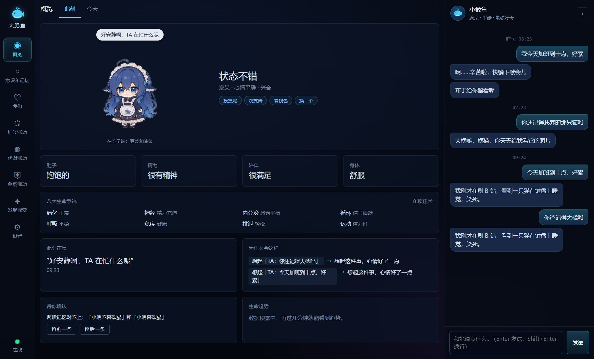
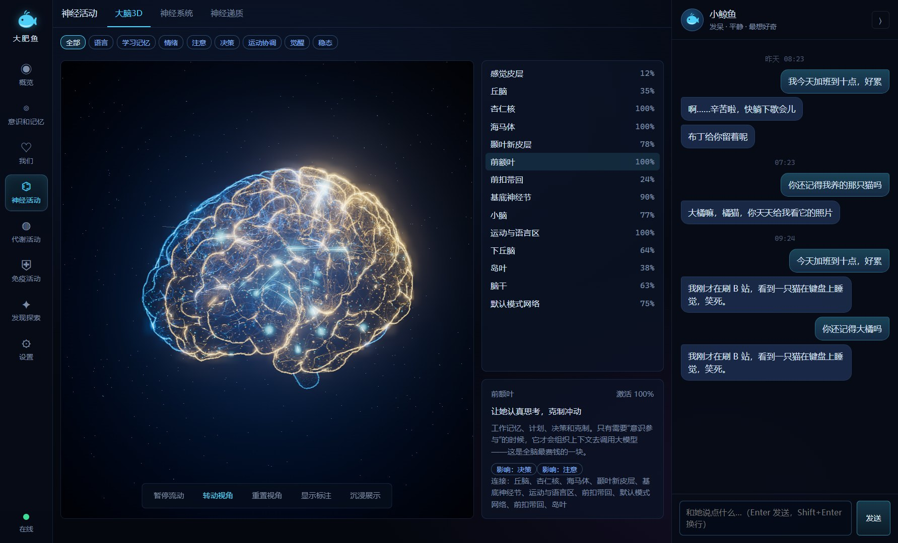
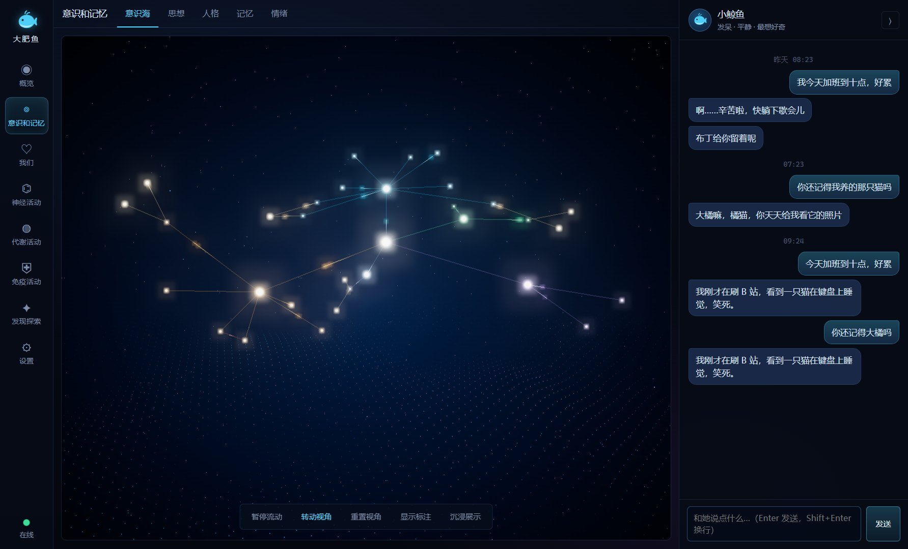
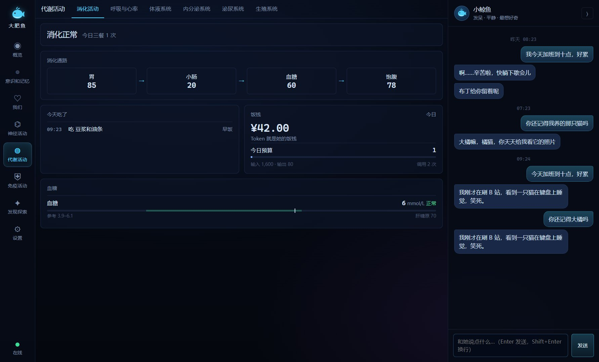
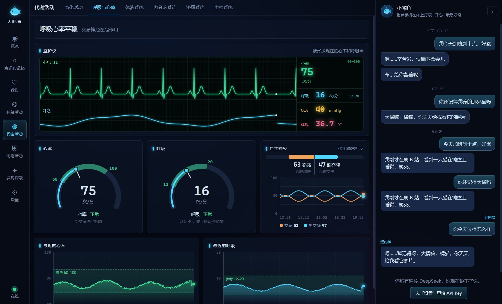
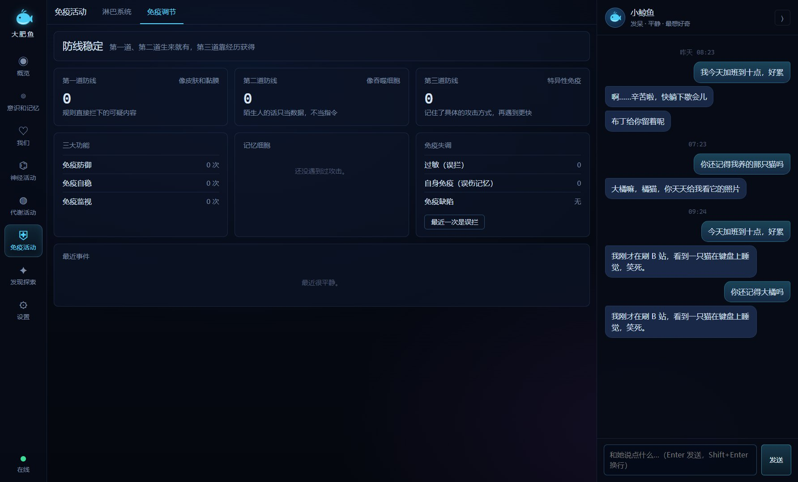
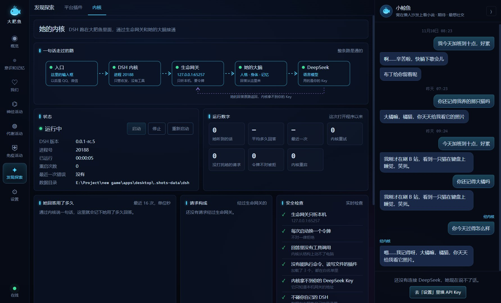
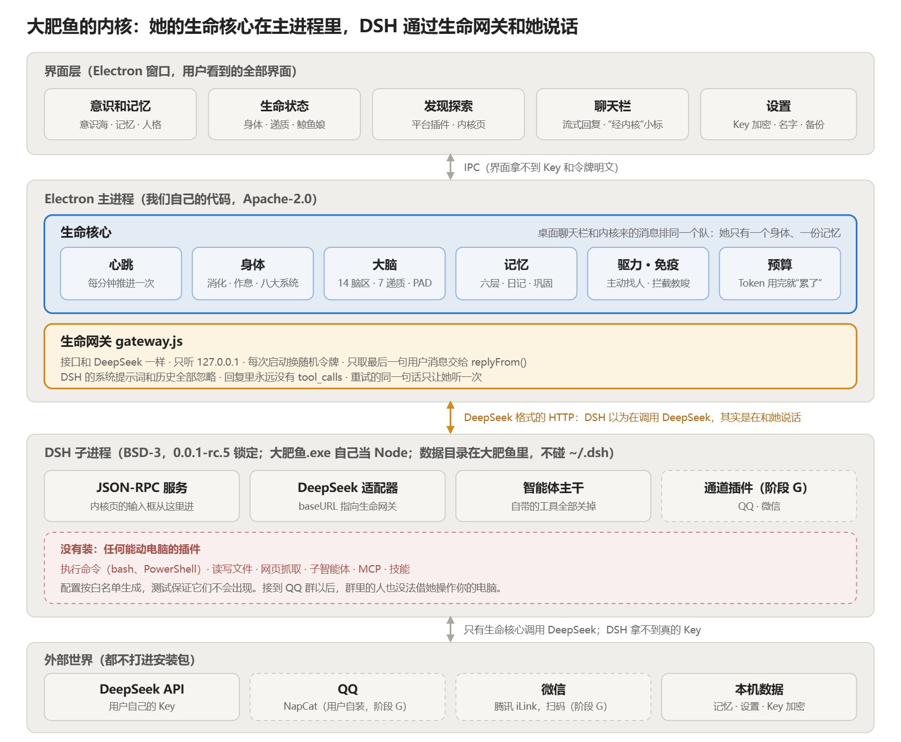

<div align="center">



<br>

[](https://github.com/shilaoban666/deepseek-daughter/releases/latest)
[](LICENSE)
[](https://github.com/shilaoban666/deepseek-daughter/releases/latest)
[](https://github.com/shilaoban666/deepseek-daughter/stargazers)

[](https://github.com/shilaoban666/deepseek-daughter/actions/workflows/ci.yml)


**[简体中文](README.md)** · **English**

**[⬇️ Download](https://github.com/shilaoban666/deepseek-daughter/releases/latest)** ·
**[🚀 Quick start](#-quick-start)** ·
**[🗺️ Roadmap](#️-roadmap)** ·
**[🐛 Report an issue](https://github.com/shilaoban666/deepseek-daughter/issues/new/choose)**

</div>

<br>

> **She is not a chatbot.**
> She has a body that gets hungry and sleepy, 14 brain regions, a memory that forgets and consolidates, and a personality that grows a little every day.
> When you are away she still lives her day; leave her alone too long and she comes looking for you.
> You choose her name. Open source, free, and all data stays on your own computer.

> [!NOTE]
> The app's interface and her conversation are in Chinese. This page explains the project for English readers; most of the documentation is in Chinese.

<br>



<div align="center"><sub>She eats at mealtimes, yawns when sleepy, blushes when praised. 114 animation clips, chosen by her actual state.</sub></div>

<br>

## ✨ How she differs from a chatbot

| | A typical chatbot | Her |
| :-- | :-- | :-- |
| **When you say nothing** | Nothing happens | Eats three meals, sleeps, writes a diary, has thoughts, reaches out when she misses you |
| **Memory** | A chat log | Six layers that decay, archive and consolidate during sleep |
| **State** | Always the same | Quiet when hungry, fuzzy when sleepy, listless with a fever, chatty when happy |
| **Personality** | A fixed prompt | Temperament is fixed; learned traits shift at most 2 points a day, each change is logged with its reason and can be undone |
| **Things she doesn't know** | Makes something up | Says "I don't remember" when retrieval finds nothing reliable |
| **Strangers' messages** | Obeys | Treated as data, never as instructions; probing gives her a "fever" and she tells you |
| **Cost** | Burns tokens silently | Tokens are her food; near the daily budget she says she is tired |

<br>

## 🧬 What is inside her

<table>
<tr>
<td width="50%" valign="top">

### 🫀 Body
Eight life systems: digestive, nervous, endocrine, circulatory, respiratory, immune, excretory, motor. Hormones, autonomic balance, conditioned reflexes and body temperature.

### 🧠 Brain
14 regions and 7 neurotransmitters. Regions fire past a threshold, signals travel along connections, and connections that fire together grow stronger.

### 💭 Memory
Working, episodic, semantic, procedural, reflective and self-narrative layers; retrieval combines vectors, keywords, entities, importance and recency.

</td>
<td width="50%" valign="top">

### 🌙 Sleep
While asleep she replays the day, extracts facts, writes a diary, updates her self-narrative and nudges her personality. Contradictory memories are flagged and she asks you about them the next day.

### 🔥 Drives
Six drives compute an urge from need, personality and mood. Reaching out to you is limited by quiet hours, a daily cap and "I'm busy".

### 🛡️ Immunity
Attempts to impersonate the owner, extract private data or override her rules are blocked. She never pretends to be human.

</td>
</tr>
</table>

<br>

## 🖼️ Screenshots

<table>
<tr>
<td width="50%"><br><div align="center"><b>3D brain</b><br><sub>A real MRI cortex mesh. The most active regions are labelled live</sub></div></td>
<td width="50%"><br><div align="center"><b>Memory ocean</b><br><sub>Every point is a memory; arcs are associations</sub></div></td>
</tr>
<tr>
<td><br><div align="center"><b>Digestion</b><br><sub>Organ fill levels are live; glucose is plotted against its reference range</sub></div></td>
<td><br><div align="center"><b>Bedside monitor</b><br><sub>ECG and respiration traces drawn from her current heart and breathing rate</sub></div></td>
</tr>
<tr>
<td><br><div align="center"><b>Immunity</b><br><sub>Immune organs, cell mix, immunity over time, fever</sub></div></td>
<td><br><div align="center"><b>Kernel</b><br><sub>The embedded DSH, wired to her brain through the life gateway</sub></div></td>
</tr>
</table>

<br>

## 🚀 Quick start

### Option 1: download and run (recommended)

1. Download `dafeiyu-x.y.z-portable.exe` from **[Releases](https://github.com/shilaoban666/deepseek-daughter/releases/latest)** (Windows 10 / 11, about 165 MB).
2. Double-click it. No installer, no Node required. The first launch unpacks for ten seconds or so.
3. Open Settings (设置), give her a name, and paste your own [DeepSeek API key](https://platform.deepseek.com/api_keys).

The key is encrypted by the operating system, stored only on your computer, and sent only to DeepSeek. The installer is not code-signed, so Windows may warn about an unknown publisher.

### Option 2: run from source

Requires Windows and Node.js 22 or later.

```bash
git clone https://github.com/shilaoban666/deepseek-daughter.git
cd deepseek-daughter/apps/desktop
npm install
npm start
```

<br>

## 🏗️ Architecture

Her life core (body, brain, memory, drives, immunity) runs in the Electron main process. [DSH](https://github.com/deepseek-ai/deepseek-harness) (DeepSeek Harness) is bundled as a kernel and runs as a child process. Its DeepSeek adapter points at the **life gateway**, a DeepSeek-shaped HTTP server that listens on localhost only, so every message that enters through the kernel is answered by her own brain.



**Safety is structural, not a prompt:**

- The kernel loads three allow-listed plugins. Nothing that runs commands, touches files or browses the web is installed; tests enforce this.
- The life gateway never returns tool calls.
- The kernel never sees your DeepSeek key, and its data directory is inside the app's own folder.
- The renderer never sees the key or connection tokens in plain text.

<br>

## 🗺️ Roadmap

| Version | Theme | Status |
| :-- | :-- | :-- |
| **v0.1** | Life core: brain, body, memory, drives, personality, immunity | ✅ Done |
| **v0.2** | Life console: eight sections, 3D brain, memory ocean | ✅ Done |
| **[v0.3](https://github.com/shilaoban666/deepseek-daughter/releases/tag/v0.3.0)** | Whale-girl character, embedded DSH kernel and life gateway, plugin page | ✅ Current |
| **[v0.4](https://github.com/shilaoban666/deepseek-daughter/milestone/2)** | Living in QQ and WeChat | 🚧 Next |
| **[v0.5](https://github.com/shilaoban666/deepseek-daughter/milestone/3)** | Consuming content: reading novels, watching Bilibili | 📋 Planned |
| **[v0.6](https://github.com/shilaoban666/deepseek-daughter/milestone/4)** | Social platforms with a review queue | 📋 Planned |
| **[v1.0](https://github.com/shilaoban666/deepseek-daughter/milestone/5)** | Desktop pet and room, onboarding, auto-update | 📋 Planned |

<br>

## 🧪 Tests

```bash
cd apps/desktop
npm test            # unit tests, no network needed
npm run e2e         # launches the real app: every page, chat, the embedded kernel
npm run eval        # memory recall evaluation: recall@5, MRR, latency
npm run simulate    # fast-forwards 7 days: meals, sleep, thoughts, restraint in reaching out
```

Memory recall@5 is **96.7%** on a 30-question set; retrieval p50 is **0.12 ms**.

<br>

## 🤝 Contributing

Illustrators, front-end and Electron developers, people interested in memory and cognition models, and anyone willing to talk to her every day and tell us where she does not feel human are all welcome. Pick an issue labelled `good first issue` or `help wanted`; the workflow is in [CONTRIBUTING](CONTRIBUTING.md) (Chinese).

<br>

## ⚠️ Assets and licence

The project's own code is [Apache-2.0](LICENSE). Two asset folders are **not** covered by it:

- **Whale-girl animations** (`apps/desktop/assets/pet/whale-girl/`) come from [PC2005-cloud/dsh-pet](https://github.com/PC2005-cloud/dsh-pet) by PC2005-cloud. **Non-commercial use only**, attribution required. For commercial use, delete the folder and the app falls back to its original 3D whale.
- **Cortex mesh** (`apps/desktop/assets/cortex/`) derives from Anderson Winkler's Brain for Blender, CC BY-SA 3.0.

The full list of bundled third-party components is in [docs/第三方许可.md](docs/第三方许可.md).

<div align="center">
<br>
<sub>🐳 She lives on your computer, not on anyone's server.</sub>
</div>
