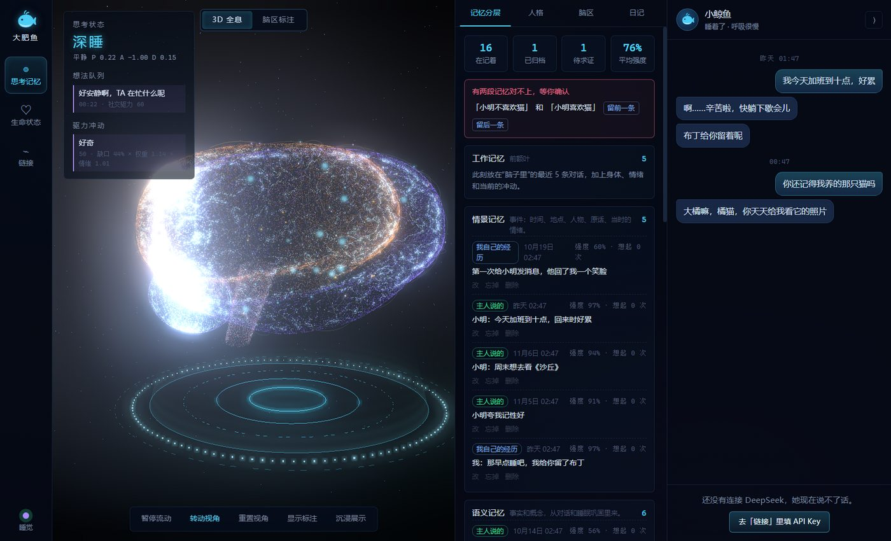
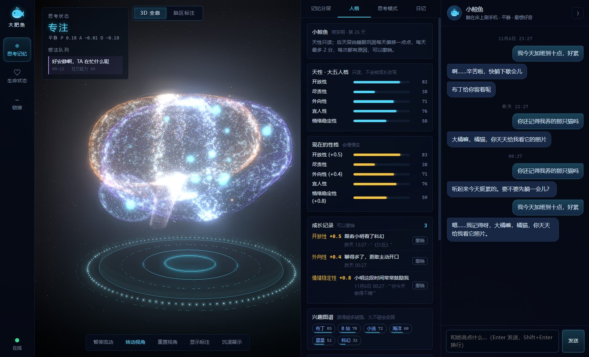
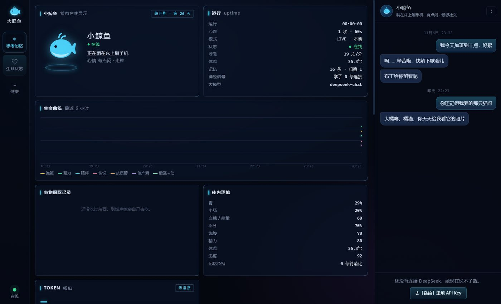
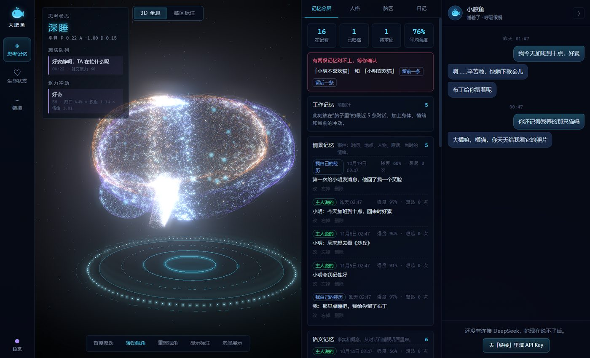
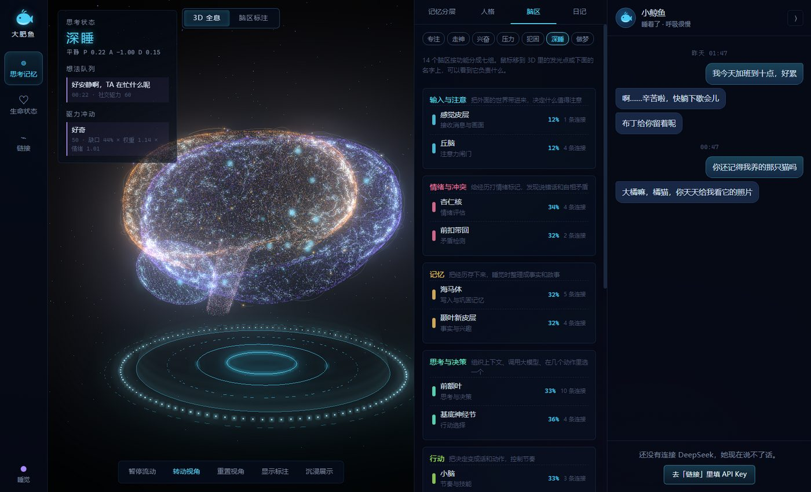

# 大肥鱼 · DeepSeek Daughter

**养一个住在网上的女孩。** 名字由你来取（默认叫小鲸鱼）。开源、免费，双击一个 exe 就能用。

她有身体、情绪和长期记忆：会饿会困，会自己看小说、刷 B 站；想你了会在 QQ 上找你；睡觉时整理一天的记忆，慢慢长成你养出来的样子。她住在 QQ、微信，以及 B站、抖音、小红书、X、YouTube 上，像一个真的朋友。

> 当前版本 v0.2：**生命核心**（大脑、身体、记忆、驱力、人格、免疫）已经能跑，桌面里能和她聊天、看她脑子里在发生什么。桌宠、房间和平台连接器按执行计划往后做。

## 她现在是什么样

- **有身体**：八套生命系统——消化、神经、内分泌、循环、呼吸、免疫、排泄、运动。Token 用量就是她的饭量，余额就是饭钱；预算快用完时她会说自己累了、想睡觉，而不是突然报错。
- **有大脑**：14 个脑区、7 种神经递质。每个脑区有激活值，超过阈值会放电，信号沿连接传到下游脑区；常一起活跃的连接会变强（赫布学习）。思考状态分专注、走神、兴奋、压力、犯困、深睡、做梦。
- **有记忆**：六层记忆（工作、情景、语义、程序、反思、自我叙事），五路混合检索（向量、关键词、实体、重要性、新鲜度），问“昨天”“早上”直接按时间取原话。记忆会按艾宾浩斯曲线衰减、归档、合并；重要的事不会被忘掉，真正删除只有你能做。
- **会睡觉整理**：睡着后回放当天、提炼事实、写日记、更新自我叙事、微调性格、检查互相矛盾的记忆，第二天拿来跟你求证。
- **有自驱力**：六种驱力按“缺口 × 性格权重 × 情绪调节”算冲动，最强的超过阈值就冒出一个想法；吃饭、睡觉这类日常行为走规则，不花 Token；主动找你受安静时段、每日上限和“我在忙”约束。
- **会长大**：天性是只读的大五人格，后天层每天最多偏移 2 分，每次偏移都记着原因和你的原话，可以一键撤销。兴趣图谱、价值观、独特经历都会慢慢长出来。
- **有免疫**：陌生人的消息只当数据、不当指令；冒充主人、套取隐私、让她忽略规则的尝试会被拦下，她会“发烧”、拒绝配合，并告诉你。
- **有礼貌**：她不会假装自己是人类，也不假装知道不知道的事——检索不到可靠记忆时，她会说“记不清了”。

## 界面

| 思考记忆 | 人格 |
| --- | --- |
|  |  |

| 生命状态 | 3D 大脑 |
| --- | --- |
|  |  |

3D 大脑可以拖动旋转、滚轮缩放；表面的光点是她的记忆，悬停能看内容，脑区激活时对应位置会发亮，神经信号画成在脑区之间飞过的光点。右侧「脑区」页按输入与注意、情绪与冲突、记忆、思考与决策、行动、稳态与觉醒、联想七组，解释了 14 个脑区各负责什么，并显示当前激活和连接数；鼠标移到 3D 里的脑区上也能直接看到它的职责。



左边「记忆分层」可以查看、修改、忘掉、恢复、彻底删除每一条记忆，也能处理两段互相矛盾的记忆；「人格」里能看到成长记录并撤销。

## 快速开始

需要 Windows、Node.js 20 以上，和一把自己的 [DeepSeek API Key](https://platform.deepseek.com/api_keys)。

```bash
cd apps/desktop
npm install
npm start
```

第一次打开后，去「设置」页给她取个名字，填上 Key，她就能说话了。Key 用系统加密只存在本机。

**没有 Key 也想看看流程？** 仓库带了一个假 DeepSeek：

```bash
# 一个终端
cd apps/desktop
node scripts/mock-deepseek.js 8787

# 另一个终端（PowerShell）
$env:DEEPSEEK_API_KEY='sk-mock'
$env:DFY_API_BASE='http://127.0.0.1:8787'
npm start
```

**想截图 / 看面板效果？**

```bash
npm run shots            # 24 个页面逐个截图，输出到 apps/desktop/.shots
node scripts/seed.js     # 往截图用的临时存档里塞一份演示数据
```

打包成单个 exe（Windows 便携版，不用安装，双击就能运行）：`npm run dist`，产物在 `apps/desktop/dist/`。第一次启动要先解压，需要十几秒。

**数据在哪？** `%APPDATA%\大肥鱼\data`——一个 `memory.json`、一个 `profile.json`，全是纯文本，可以直接拷走换电脑。想改数值（饥饱速度、驱力阈值、检索权重……）就在同目录放一份 `config.json`，字段见 [`config/default.json`](apps/desktop/config/default.json)。

## 她自己会做的事

- 按时吃三餐和下午茶；夜里睡觉，睡前写日记。
- 每聊 3 句整理一次对话里的新事实；每次心跳算一遍驱力和冲动。
- 太久没人理她会主动找你（有安静时段、每日上限；你说“我在忙”之后的 2 小时她不会打扰）。
- 读完一本书、看完一个视频会写读书笔记，把内容“消化”成记忆（内容消费在阶段 4 接）。
- 被陌生人试探会拒绝、会发烧，然后把这件事告诉你。

## 测试与评估

```bash
cd apps/desktop
npm test            # 单元测试，不需要网络
npm run e2e         # 启动真实应用，走完 24 个页面、聊天、身心闭环和性能检查
npm run eval        # 记忆召回评估集：recall@5、MRR、检索延迟
npm run simulate    # 模拟时钟快进 7 天，检查吃饭、睡觉、想法分布、主动找人的克制
```

评估集的题目和记忆在 [`eval/dataset.json`](apps/desktop/eval/dataset.json)，加题就能扩大规模。目前 recall@5 是 96.7%（30 题），检索 p50 在 0.1ms 级。

## 文档

- [设计文档](docs/设计文档.md)：她是什么、脑区模型、八大生命系统、记忆、自驱力、平台连接、界面与美术、技术栈、参考项目和许可证。
- [执行计划](docs/执行计划.md)：阶段 0 到阶段 6 的任务清单。
- [实现进度](docs/实现进度.md)：设计文档的每一节对应到哪个文件、哪个测试，还差什么。

## 架构

大肥鱼是一个桌面程序。DSH（DeepSeek Harness）作为内核打包在里面，用户不用另装。我们的生命核心（身体、大脑、记忆、驱力）和精选的 QQ、微信通道插件都以 DSH 插件的形式装在内核里，所以不管从哪里找她，她都是同一个人、同一份记忆。DSH 默认带的执行命令、读写文件等编程工具全部关闭。


> 现状：桌面程序目前直接调用 DeepSeek API，下一步把 DSH 内核嵌进去。

## 技术栈与目录

| 部分 | 选型 |
|---|---|
| 大模型 | DeepSeek API（直接调用，用户填自己的 Key） |
| 桌面外壳 | Electron，之后打包成单个 exe |
| 生命核心 | 原生 JavaScript + Node 内置测试框架，不依赖框架 |
| 记忆 | 本地 JSON（接口已经按 SQLite + 向量检索设计，换后端只改 `memory.js`） |
| 界面 | 原生 DOM + three.js 全息大脑（真实 MRI 皮层网格） |

```
apps/desktop/
├── config/default.json      所有可调参数
├── src/main/
│   ├── neural.js            脑区、神经信号、连接权重、思考状态
│   ├── body.js              八大生命系统、递质、HPA、Token 预算
│   ├── life.js              心跳、作息、三餐、主动找人的克制
│   ├── drives.js            六种驱力、想法队列、规则行为
│   ├── persona-model.js     天性、后天性格、兴趣、成长记录
│   ├── memory.js            六层记忆、五路检索、遗忘、溯源、矛盾
│   ├── consolidate.js       睡眠巩固
│   ├── immune.js            免疫系统（提示词注入、冒充、隐私）
│   ├── intent.js            从一句话里读意图
│   ├── backup.js            每日备份
│   ├── daughter.js          把上面这些串起来
│   └── main.js / preload.js Electron 主进程与 IPC
├── src/main/physiology/     内环境、激素、自主神经、反射、免疫、身心闭环
├── src/renderer/views/      八个板块的页面
├── src/renderer/            两级导航、3D 大脑、意识海、3D 形象、聊天
├── eval/                    记忆召回和驱力模拟
└── test/                    单元与端到端测试
```

## 一起来养她

| 方向 | 做什么 |
|---|---|
| 插画与角色美术 | 原创形象、房间插画（分层）、角色动作 |
| 前端 / Electron | 桌宠窗口、房间场景、首次启动引导 |
| 大脑与记忆 | 脑区模型、记忆检索与睡眠巩固、驱力调参 |
| 平台连接器 | QQ、微信、B站、小红书、抖音……每个平台一个独立的包 |
| 养她的人 | 天天跟她聊天，告诉我们她哪里不像人 |

想参与的话，在 Issues 里留言认领，开发流程见 [CONTRIBUTING](CONTRIBUTING.md)。交流群即将公开。

## 风险声明

- 平台自动化（QQ、微信、B站等）可能触发风控，**封号风险由使用者自己承担**。本项目目前尚未包含这些连接器；接入后会默认只读、默认进审核队列。
- 所有记忆和登录状态只存在本机。请自己保管好 API Key 和数据目录。
- 如果你把本项目做成面向公众的在线服务，需要按当地法规完成生成式 AI 服务备案，并做好内容安全和未成年人保护。

## 素材许可

仓库只收原创素材，或 CC0、CC-BY、OFL 许可的素材。别人的作品（包括风格参考图）不放进仓库。

唯一的例外是 3D 大脑的皮层数据（`apps/desktop/assets/cortex/`）：网格来自 Anderson Winkler 的 Brain for Blender，经 [memory-brain](https://github.com/peterpoal134/memory-brain) 转换，许可是 CC BY-SA 3.0，这部分数据及其衍生数据不适用 Apache-2.0，署名见该目录的 `LICENSE-ATTRIBUTION.md`。

## 许可证

[Apache-2.0](LICENSE)
