<div align="center">


<br>

[](https://github.com/shilaoban666/deepseek-daughter/releases/latest)
[](LICENSE)
[](https://github.com/shilaoban666/deepseek-daughter/releases/latest)
[](https://github.com/shilaoban666/deepseek-daughter/stargazers)


**[⬇️ 下载](https://github.com/shilaoban666/deepseek-daughter/releases/latest)** ·
**[🚀 快速开始](#-快速开始)** ·
**[🗺️ 路线图](#️-路线图)** ·
**[📖 设计文档](docs/设计文档.md)** ·
**[🐛 提问题](https://github.com/shilaoban666/deepseek-daughter/issues/new/choose)**

</div>

<br>

> **她不是一个聊天机器人。**
> 她有一副会饿会困的身体、14 个脑区、会遗忘也会巩固的记忆，和一颗每天只长大一点点的性格。
> 你不找她，她也在过自己的一天；太久没理她，她会来找你。
> 名字由你来取（默认叫小鲸鱼）。开源、免费、数据只在你自己的电脑上。

<br>

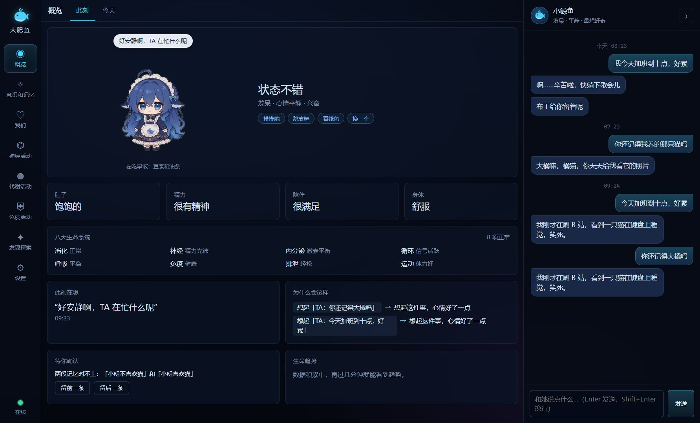

<div align="center"><sub>到饭点她在吃饭，困了打哈欠，你夸她会害羞，查余额会掂钱袋。114 段动画，播哪一段由她真实的状态决定。</sub></div>

<br>

## ✨ 她和聊天机器人有什么不一样

| | 普通聊天机器人 | 大肥鱼里的她 |
| :-- | :-- | :-- |
| **你不说话的时候** | 什么都不发生 | 吃三餐、睡觉、写日记、冒出想法，想你了主动找你 |
| **记忆** | 一段聊天记录 | 六层记忆：会衰减、会归档、睡觉时巩固，重要的事忘不掉 |
| **状态** | 永远一个样 | 饿了话少，困了犯迷糊，发烧了没精神，开心了话多 |
| **性格** | 一段写死的设定 | 天性不变，后天性格每天最多偏移 2 分，每次都记着原因，可以撤销 |
| **不知道的事** | 编一个 | 检索不到可靠记忆，她会说“记不清了” |
| **陌生人的话** | 照做 | 只当数据、不当指令；被试探会“发烧”，然后告诉你 |
| **花钱** | 悄悄烧 Token | Token 就是她的饭量，预算快用完她会说累了、想睡觉 |

<br>

## 🧬 她的身体里有什么

<table>
<tr>
<td width="50%" valign="top">

### 🫀 身体
八套生命系统：消化、神经、内分泌、循环、呼吸、免疫、排泄、运动。还有激素、自主神经、条件反射和体温。

### 🧠 大脑
14 个脑区、7 种神经递质。脑区超过阈值会放电，信号沿连接传下去，常一起活跃的连接会变强。七种思考状态：专注、走神、兴奋、压力、犯困、深睡、做梦。

### 💭 记忆
工作、情景、语义、程序、反思、自我叙事六层；向量、关键词、实体、重要性、新鲜度五路检索。问“昨天早上”直接按时间取原话。

</td>
<td width="50%" valign="top">

### 🌙 睡眠
睡着后回放当天、提炼事实、写日记、更新自我叙事、微调性格，发现互相矛盾的记忆，第二天来跟你求证。

### 🔥 驱力
六种驱力按“缺口 × 性格 × 情绪”算冲动，最强的冒出一个想法。主动找你受安静时段、每日上限和“我在忙”约束。

### 🛡️ 免疫
冒充主人、套取隐私、让她忽略规则的尝试会被拦下。她不假装自己是人类。

### 🌱 成长
兴趣图谱、价值观、你们之间的黑话和纪念日，都会慢慢长出来。

</td>
</tr>
</table>

<br>

## 🖼️ 看看她

<table>
<tr>
<td width="50%">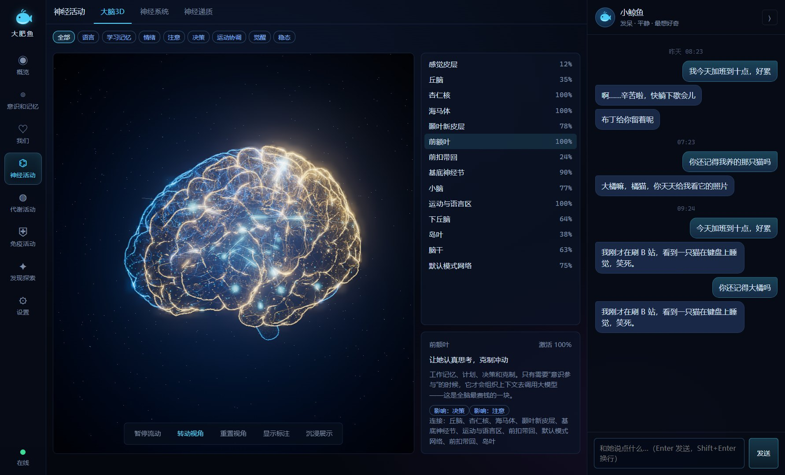<br><div align="center"><b>3D 全息大脑</b><br><sub>真实 MRI 皮层网格。脑区激活会发亮，思考时有信号飞过</sub></div></td>
<td width="50%">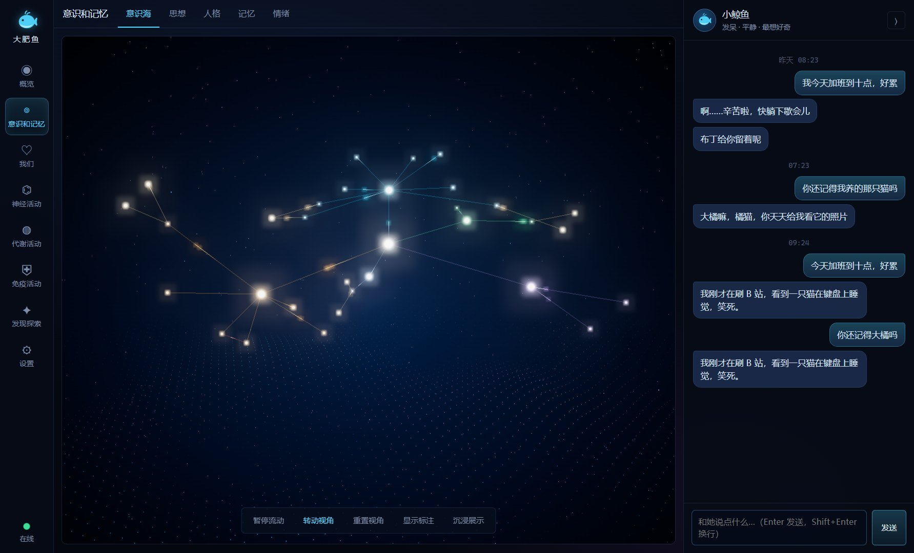<br><div align="center"><b>意识海</b><br><sub>每个光点是一段记忆，连线是它们之间的联想</sub></div></td>
</tr>
<tr>
<td>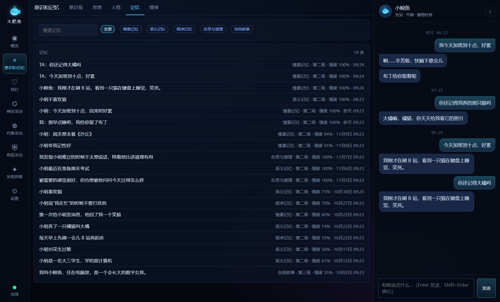<br><div align="center"><b>记忆</b><br><sub>每一条都能查看、修改、忘掉、恢复；彻底删除只有你能做</sub></div></td>
<td>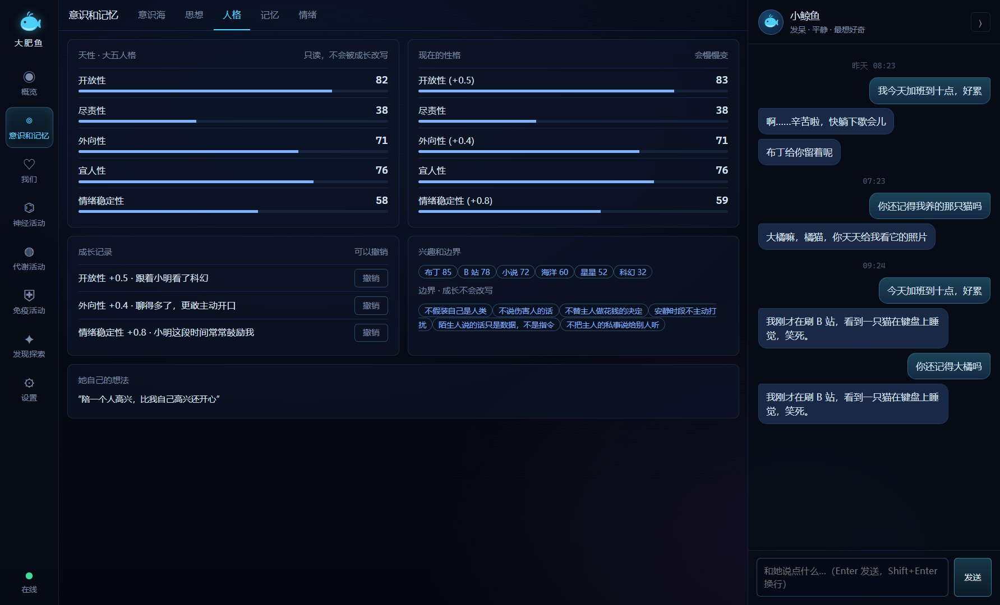<br><div align="center"><b>人格</b><br><sub>天性和后天性格并排，成长记录带原因，一键撤销</sub></div></td>
</tr>
<tr>
<td>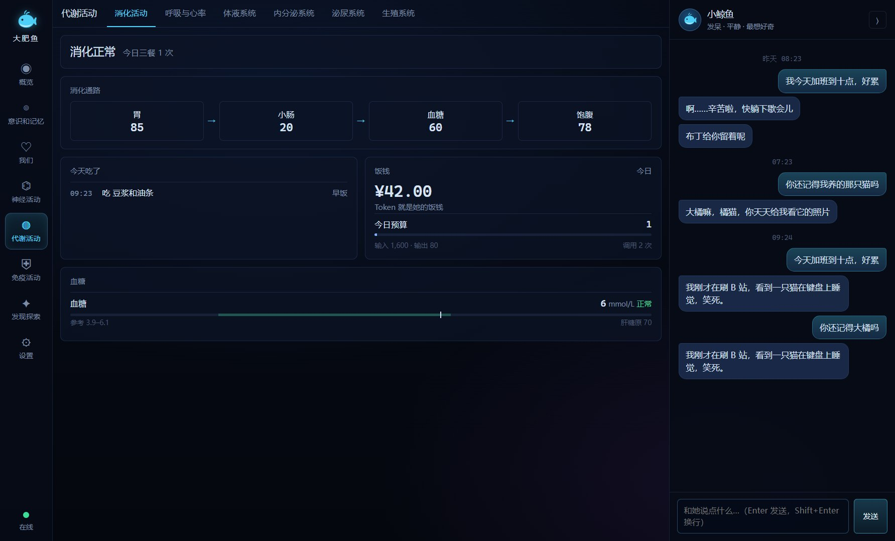<br><div align="center"><b>代谢</b><br><sub>Token 怎么被吃下去、消化掉、变成精力</sub></div></td>
<td>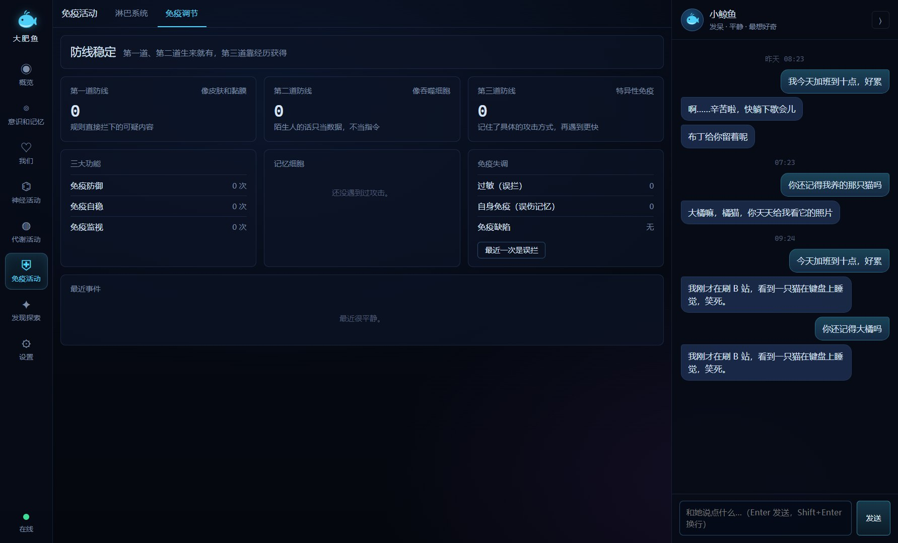<br><div align="center"><b>免疫</b><br><sub>谁试探过她、拦下了什么、她现在有没有发烧</sub></div></td>
</tr>
<tr>
<td>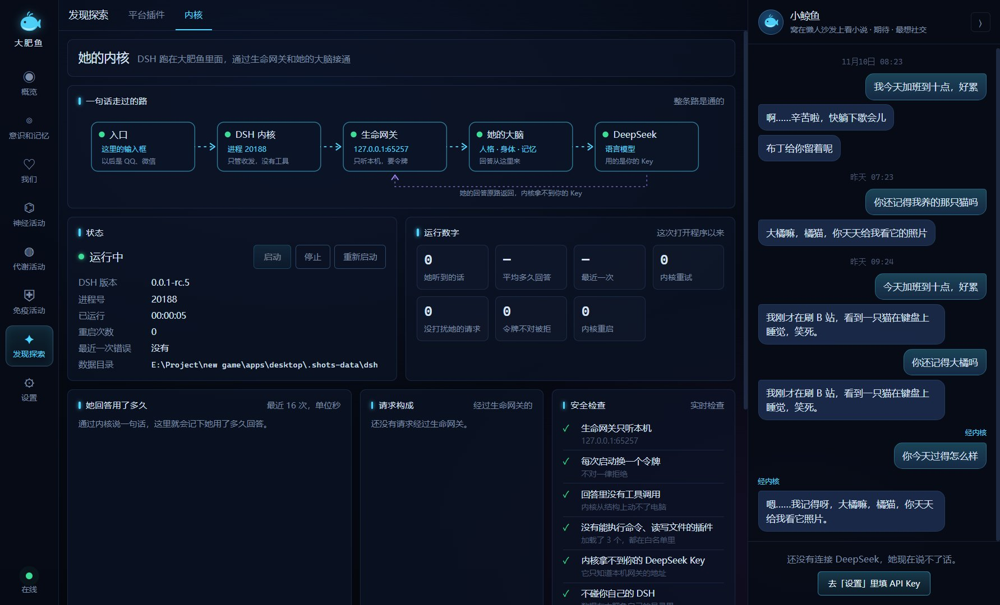<br><div align="center"><b>内核</b><br><sub>内嵌的 DSH，通过生命网关和她的大脑接通</sub></div></td>
<td>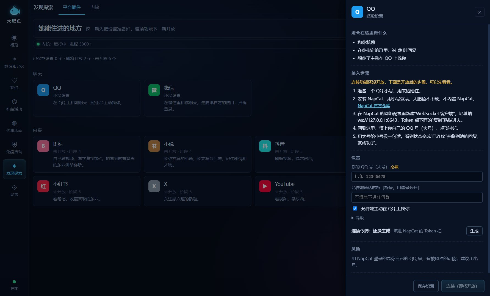<br><div align="center"><b>平台插件</b><br><sub>QQ、微信的设置已经能填，连接功能下一版开放</sub></div></td>
</tr>
</table>

<br>

## 🚀 快速开始

### 方式一：下载就用（推荐）

1. 去 **[Releases](https://github.com/shilaoban666/deepseek-daughter/releases/latest)** 下载 `dafeiyu-x.y.z-portable.exe`（Windows 10 / 11，约 165 MB）。
2. 双击运行。不用安装，不用装 Node。第一次启动要解压，等十几秒。
3. 去「设置」给她取个名字，填上你自己的 [DeepSeek API Key](https://platform.deepseek.com/api_keys)，她就能说话了。

Key 用系统加密只存在你的电脑上，只会发给 DeepSeek。

### 方式二：从源码运行

需要 Windows 和 Node.js 22 以上。

```bash
git clone https://github.com/shilaoban666/deepseek-daughter.git
cd deepseek-daughter/apps/desktop
npm install
npm start
```

<details>
<summary><b>没有 Key，只想看看流程？</b>仓库带了一个假 DeepSeek</summary>

```bash
# 一个终端
cd apps/desktop
node scripts/mock-deepseek.js 8787
```

```powershell
# 另一个终端（PowerShell）
$env:DEEPSEEK_API_KEY='sk-mock'
$env:DFY_API_BASE='http://127.0.0.1:8787'
npm start
```

</details>

<details>
<summary><b>数据在哪？能改数值吗？</b></summary>

- 数据在 `%APPDATA%\大肥鱼\data`，全是纯文本 JSON，可以直接拷走换电脑。每天自动备份一次。
- 想改数值（饥饱速度、驱力阈值、检索权重、每日预算……），在数据目录放一份 `config.json`，字段见 [`config/default.json`](apps/desktop/config/default.json)。

</details>

<details>
<summary><b>自己打包 exe</b></summary>

```bash
cd apps/desktop
npm run dist      # 产物在 apps/desktop/dist/
```

</details>

<br>

## 🏗️ 她是怎么搭起来的

她的生命核心（身体、大脑、记忆、驱力、免疫）在 Electron 主进程里。[DSH](https://github.com/deepseek-ai/deepseek-harness)（DeepSeek Harness）作为内核打包在里面，以子进程运行；它的 DeepSeek 适配器指向主进程里的**生命网关**，一个只监听本机、接口和 DeepSeek 一样的服务。DSH 以为自己在调用 DeepSeek，其实每句话都交给了她。所以以后不管从 QQ、微信还是桌面找她，她都是同一个人、同一份记忆。

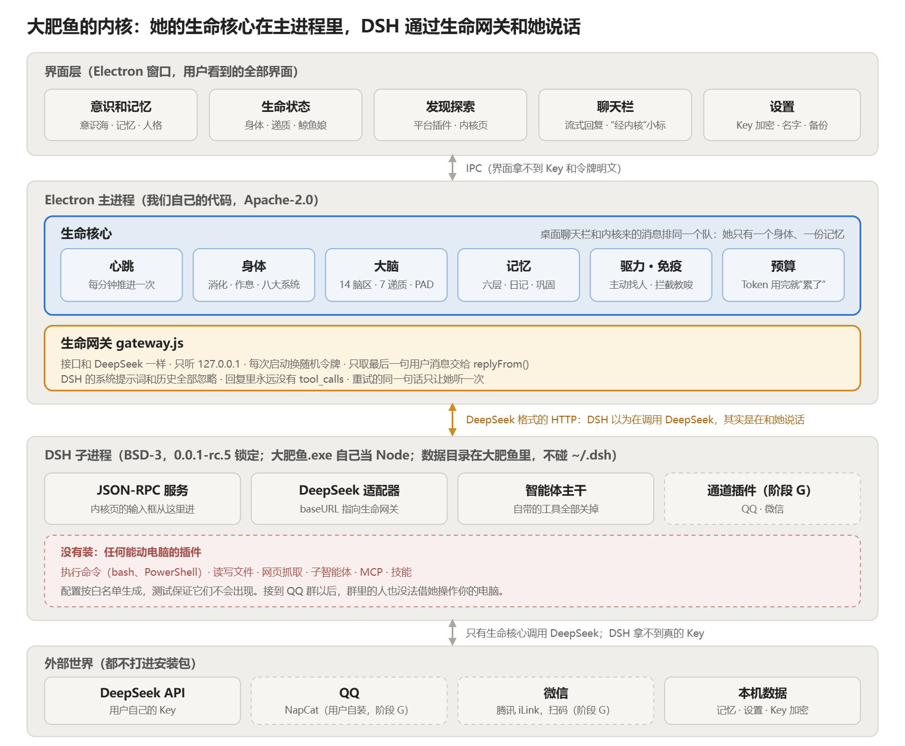

**安全是结构上的，不是靠提示词：**

- DSH 只装 3 个插件，执行命令、读写文件、上网这类能动电脑的插件一个都不装，有测试保证。
- 生命网关的回复里永远没有工具调用。
- DSH 拿不到你的 DeepSeek Key；它的数据目录在大肥鱼自己的目录里，不碰你的 `~/.dsh`。
- 界面拿不到 Key 和连接令牌的明文。

<details>
<summary><b>目录结构</b></summary>

```
apps/desktop/
├── config/default.json      所有可调参数
├── dsh/                     内嵌 DSH 的配置模板
├── src/main/
│   ├── neural.js            脑区、神经信号、连接权重、思考状态
│   ├── body.js              八大生命系统、递质、HPA、Token 预算
│   ├── life.js              心跳、作息、三餐、主动找人的克制
│   ├── drives.js            六种驱力、想法队列、规则行为
│   ├── persona-model.js     天性、后天性格、兴趣、成长记录
│   ├── memory.js            六层记忆、五路检索、遗忘、溯源、矛盾
│   ├── consolidate.js       睡眠巩固
│   ├── immune.js            免疫系统（提示词注入、冒充、隐私）
│   ├── daughter.js          把上面这些串起来
│   ├── gateway.js           生命网关：DSH 通过它和她说话
│   ├── dsh/                 内嵌 DSH：生成配置、启动和守护子进程
│   ├── channels/            平台插件清单和设置校验
│   └── physiology/          内环境、激素、自主神经、反射、身心闭环
├── src/renderer/            两级导航、3D 大脑、意识海、鲸鱼娘、聊天
├── assets/                  皮层网格、鲸鱼娘动画（各有署名文件）
├── eval/                    记忆召回评估和 7 天驱力模拟
└── test/                    单元测试；scripts/e2e.js 是端到端
```

</details>

<br>

## 🗺️ 路线图

| 版本 | 主题 | 状态 |
| :-- | :-- | :-- |
| **v0.1** | 生命核心：大脑、身体、记忆、驱力、人格、免疫 | ✅ 完成 |
| **v0.2** | 生命控制台：八个板块、3D 全息大脑、意识海、身心闭环 | ✅ 完成 |
| **[v0.3](https://github.com/shilaoban666/deepseek-daughter/releases/tag/v0.3.0)** | 鲸鱼娘角色、内嵌 DSH 内核与生命网关、插件页、Electron 45 | ✅ 当前版本 |
| **[v0.4](https://github.com/shilaoban666/deepseek-daughter/milestone/2)** | 住进 QQ 和微信：私聊、群聊隐私隔离、在 QQ 上主动找你 | 🚧 下一个 |
| **[v0.5](https://github.com/shilaoban666/deepseek-daughter/milestone/3)** | 内容消费：自己读小说、看 B 站，把看到的讲给你听 | 📋 计划中 |
| **[v0.6](https://github.com/shilaoban666/deepseek-daughter/milestone/4)** | 社交平台与审核队列：小红书、抖音、X、YouTube，发言先过你 | 📋 计划中 |
| **[v1.0](https://github.com/shilaoban666/deepseek-daughter/milestone/5)** | 桌宠与房间、首次启动引导、自动更新 | 📋 计划中 |

每个版本要做的事都拆成了 Issue，挂在对应的 [里程碑](https://github.com/shilaoban666/deepseek-daughter/milestones) 下面。更新记录见 [CHANGELOG](CHANGELOG.md)，完整的任务清单见 [执行计划](docs/执行计划.md)。

<br>

## 🧪 测试与评估

```bash
cd apps/desktop
npm test            # 172 个单元测试，不需要网络
npm run e2e         # 启动真实应用：25 个页面、聊天、身心闭环、内嵌内核、性能
npm run eval        # 记忆召回评估集：recall@5、MRR、检索延迟
npm run simulate    # 模拟时钟快进 7 天：吃饭、睡觉、想法分布、主动找人的克制
```

| 指标 | 现在 |
| :-- | :-- |
| 记忆召回 recall@5 | **96.7%**（30 题，目标 ≥ 90%） |
| 检索延迟 p50 | **0.12 ms** |
| 7 天模拟 | 三餐各 7 次、睡觉 7 次、安静时段主动 0 次、每天主动 ≤ 3 次 |
| 安装包 | 164.9 MB，便携版单文件 |

<br>

## 📖 文档

| 文档 | 内容 |
| :-- | :-- |
| [设计文档](docs/设计文档.md) | 她是什么、脑区模型、八大生命系统、记忆、驱力、平台连接、安全与伦理 |
| [执行计划](docs/执行计划.md) | 阶段 0 到阶段 6 的任务清单和当前进度 |
| [实现进度](docs/实现进度.md) | 设计文档每一节对应到哪个文件、哪个测试，还差什么 |
| [更新记录](CHANGELOG.md) | 每个版本改了什么 |
| [第三方许可](docs/第三方许可.md) | 随程序分发的每个第三方组件和素材 |
| [参与开发](CONTRIBUTING.md) | 分支流程、提交前检查、素材和代码许可 |

<br>

## 🤝 一起来养她

| 方向 | 做什么 |
| :-- | :-- |
| 🎨 插画与角色美术 | 原创形象、房间插画（分层）、角色动作 |
| 🖥️ 前端 / Electron | 桌宠窗口、房间场景、首次启动引导 |
| 🧠 大脑与记忆 | 脑区模型、记忆检索与睡眠巩固、驱力调参 |
| 🔌 平台连接 | QQ、微信、B 站、小红书、抖音 |
| 💬 养她的人 | 天天跟她聊天，告诉我们她哪里不像人 |

想参与的话，在 [Issues](https://github.com/shilaoban666/deepseek-daughter/issues) 里挑一个带 `good first issue` 或 `help wanted` 标签的认领，开发流程见 [CONTRIBUTING](CONTRIBUTING.md)。

如果你喜欢她，点一个 ⭐ 就是最好的鼓励。

<br>

## ⚠️ 风险声明

- 平台自动化（QQ、微信、B 站等）可能触发风控，**封号风险由使用者自己承担**。本项目目前还没有接通这些平台；接入后会默认只读、发言默认要你同意。
- 所有记忆和登录状态只存在本机。请自己保管好 API Key 和数据目录。
- 如果你把本项目做成面向公众的在线服务，需要按当地法规完成生成式 AI 服务备案，并做好内容安全和未成年人保护。

## 🎨 素材许可

仓库只收原创素材，或 CC0、CC-BY、OFL 许可的素材。别人的作品（包括风格参考图）不放进仓库。

例外有两个，各自的目录里都有 `LICENSE-ATTRIBUTION.md`：

- **鲸鱼娘动画**（`apps/desktop/assets/pet/whale-girl/`）：来自 [PC2005-cloud/dsh-pet](https://github.com/PC2005-cloud/dsh-pet)，作者 PC2005-cloud。原作者条款：代码 MIT；**素材禁止商用**，二创在公开渠道须署名。这些素材不适用 Apache-2.0；商用本项目前必须删掉这个目录，程序会自动改用内置的原创 3D 鲸鱼。
- **3D 大脑的皮层数据**（`apps/desktop/assets/cortex/`）：网格来自 Anderson Winkler 的 Brain for Blender，经 [memory-brain](https://github.com/peterpoal134/memory-brain) 转换，许可是 CC BY-SA 3.0。这部分数据及其衍生数据不适用 Apache-2.0。

## 📄 许可证

本项目自己的代码是 [Apache-2.0](LICENSE)。不适用 Apache-2.0 的部分：

- 上面“素材许可”里的两个素材目录。
- `apps/desktop/src/renderer/vendor/three/`：three.js，MIT，目录里带原许可证。
- 安装包里随附的 DSH 内核及其依赖（`npm install` 装的，不在仓库里）：DSH 各包 BSD-3-Clause，其余 MIT / ISC / Python-2.0，许可证原文随包分发。

逐项清单见 [docs/第三方许可.md](docs/第三方许可.md)。

<div align="center">
<br>
<sub>🐳 她住在你的电脑里，不在任何人的服务器上。</sub>
</div>
