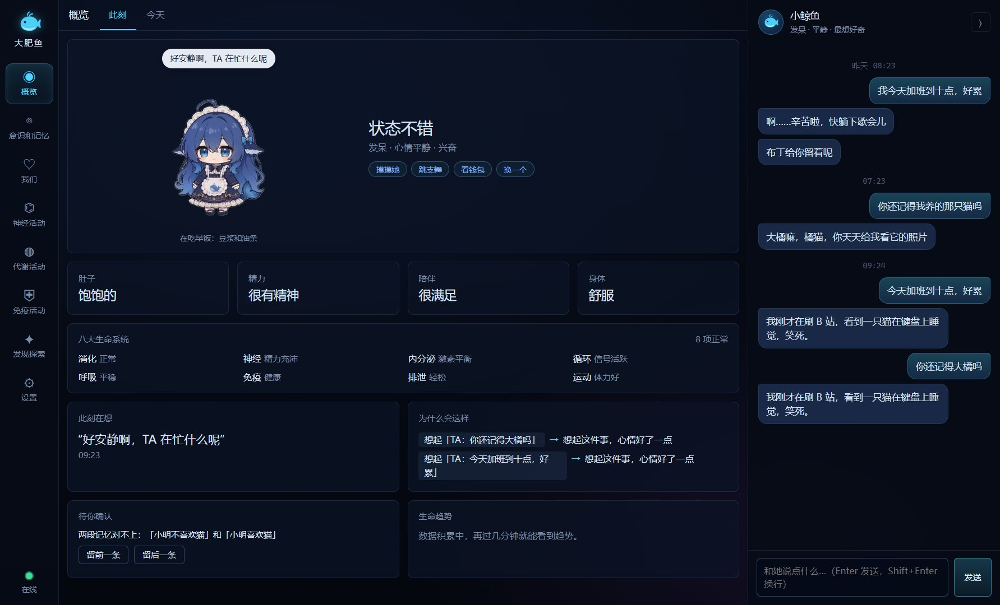

## 🐳 大肥鱼 v0.3.0：她有了样子，也有了内核

第一个公开发布的版本。下载下面的 `dafeiyu-0.3.0-portable.exe`，双击就能用：不用安装，不用装 Node。第一次启动要解压，等十几秒；然后去「设置」填上你自己的 [DeepSeek API Key](https://platform.deepseek.com/api_keys)。

### ✨ 新东西

- **鲸鱼娘**：概览页的她是一个会动的角色，114 段动画由她真实的身体、情绪、作息和聊天事件决定。到饭点吃对应的那顿饭，困了打哈欠，夸她会害羞，节日当天会过节。点一下摸摸她，按住能拎起来，右键能点播全部动画。
- **内嵌 DSH 内核**：DSH（DeepSeek Harness）打包在程序里，通过“生命网关”和她的大脑接通。「发现探索 › 内核」能启动、停止、看状态，还能通过内核跟她说一句话。这是下一版接通 QQ、微信的地基。
- **平台插件页**：QQ、微信和 6 个内容平台都能点开、填设置、看接入步骤。连接功能下一版开放。
- **Electron 45**（Node 24、Chromium 156）。

### 🛡️ 安全

- 内核里只装 3 个插件，没有任何能执行命令或读写文件的工具；生命网关的回复里永远没有工具调用。
- 内核拿不到你的 DeepSeek Key；Key 和连接令牌用系统加密存放，界面拿不到明文。
- 内核的数据目录在大肥鱼自己的目录里，不碰你电脑上已有的 `~/.dsh`。

### 🔧 修好的问题

- 陌生人说的话不会再被睡眠巩固提炼成“主人的事实”。
- 睡眠巩固时模型返回的不是 JSON，不再丢掉当天的整理。
- 每日 Token 预算用完后，主动消息、记忆提炼、睡眠整理也都停下来。

### 🧪 这一版测了什么

172 个单元测试、8 个端到端场景（包括真实拉起内核、杀掉后自动恢复、退出无残留进程）全过；记忆召回 recall@5 96.7%；7 天驱力模拟通过。

### 📦 下载

| 文件 | 大小 | SHA-256 |
| :-- | :-- | :-- |
| `dafeiyu-0.3.0-portable.exe` | 164.9 MB | `428959b0116c9812786778ccaa32994d30739880828d4a31935bf9b36fc4b042` |

- 系统：Windows 10 / 11，64 位。
- 安装包没有代码签名，Windows 可能提示“未知发布者”，点“仍要运行”。
- 你的数据在 `%APPDATA%\大肥鱼\data`，升级不会动它。

### ⚠️ 素材许可

安装包里的鲸鱼娘动画来自 [PC2005-cloud/dsh-pet](https://github.com/PC2005-cloud/dsh-pet)（作者 PC2005-cloud），**素材禁止商用**。本项目自己的代码是 Apache-2.0；逐项清单见 [第三方许可](https://github.com/shilaoban666/deepseek-daughter/blob/v0.3.0/docs/第三方许可.md)。

完整更新记录见 [CHANGELOG](https://github.com/shilaoban666/deepseek-daughter/blob/master/CHANGELOG.md)。下一版 v0.4 的目标是让她住进 QQ 和微信，任务在 [里程碑](https://github.com/shilaoban666/deepseek-daughter/milestones) 里。
