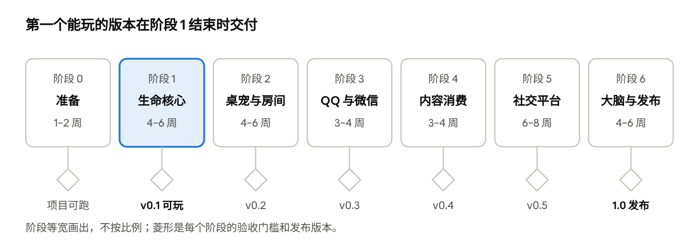

# DeepSeek Daughter（暂名）执行计划

> 原工作名“像素生命体”。代码仓库：https://github.com/shilaoban666/deepseek-daughter

2026-11-05 · 在线版：https://claude.ai/artifact/6ztKh8gTaqUqpUgUyNNWPf

## 总览

整个项目分 7 个阶段（阶段 0 到阶段 6）。按一两个人业余开发估算，全部完成大约需要 9 到 12 个月。第一个可以玩的版本在阶段 1 结束时交付，约开工后 6 周。配套的设计文档是 [设计文档.md](设计文档.md)。

| 阶段 | 内容 | 估计工期 | 交付物 |
| --- | --- | --- | --- |
| 0 准备 | 仓库、许可证、角色设定、DSH 锁版 | 1–2 周 | 可以跑的空项目，加上角色草图 |
| 1 生命核心 MVP | 身体、情绪、记忆、驱力、人格，在聊天窗口里验证 | 4–6 周 | 会饿会困、会主动找你、记得你的她 |
| 2 桌宠与房间 | 角色动画、桌宠、插画房间与光照 | 4–6 周 | 看得见她在生活 |
| 3 QQ 与微信 | OneBot 连接器、微信连接器、群聊隔离 | 3–4 周 | 她住进了你的 QQ 和微信 |
| 4 内容消费 | 小说、字幕、消化成记忆 | 3–4 周 | 她会看书、看视频，并和你聊读后感 |
| 5 社交平台 | YouTube、X、B站、抖音、小红书，审核队列 | 6–8 周 | 她在各平台上有自己的账号和生活 |
| 6 3D 大脑与发布 | three.js 大脑、安装引导、exe 打包、文档 | 4–6 周 | 1.0 开源发布 |

**开发原则**：

1. **每个阶段结束都能独立玩**：发一个预览版，让早期用户试用并反馈。
2. **先做灵魂，再做皮囊**：生命核心不好玩的话，画面再好看也没用。
3. **一个连接器一个包**：某个平台失效时不影响其他部分，社区也能单独贡献。
4. **参数全部配置化**：体力消耗、情绪半衰期、驱力阈值都写进配置文件，方便调优。
5. **每个阶段都有验收标准**：达不到就不进入下一阶段。

## 路线图

每个阶段只有达到验收标准才发布对应版本。美术工作可以从阶段 0 开始，和阶段 1 并行。

## 阶段 0：准备（1–2 周）

目标是搭好能跑的空项目，并把影响全局的决定定下来。

**任务**：

- [ ] 定项目名和角色名（许可证已定为 Apache-2.0，仓库名 deepseek-daughter）。
- [ ] 在 GitHub 建仓库，用 pnpm workspace 建 monorepo：`packages/life-core`、`packages/connectors`、`apps/desktop`、`apps/room`、`apps/brain-view`、`assets`。
- [ ] 配好 TypeScript、ESLint、Prettier、Vitest 和 GitHub Actions（自动跑测试）。
- [ ] 本地跑通 DSH（`npx @deepseek-ai/dsh web`），选定并锁定一个版本号。
- [ ] 读 DSH 的插件文档，写一个“hello world”插件并让 DSH 加载它。
- [ ] 精读三个参考仓库的源码：qq-bridge 怎么和 DSH 对接；WeChatAgent 怎么接微信；memory-brain 的记忆表结构和检索权重。写成笔记放进 `docs/`。
- [ ] 确认 dsh-pet 的许可证。
- [ ] 试用 [dsh-memory](https://github.com/FuRongJun-1999/dsh-memory) 2–3 天：挂到 DSH 上，测它的召回效果，并评估它的 Python 和 Rust 依赖能否打进 exe。据此决定是直接拿它做记忆后端，还是只借鉴设计。
- [ ] **角色设定**：写一页人设，包括外观、天性（大五人格打分）、说话风格和初始兴趣。
- [ ] **角色美术草图**：一张原创立绘（Q 版，适合放进俯视房间），加一张房间夜景概念图。风格定为温馨的日系插画。
- [ ] 写好 README、CONTRIBUTING 和风险声明（平台自动化的封号风险由用户自己承担）。

**验收**：`pnpm dev` 能启动 DSH，并加载我们的空插件；角色草图获得认可。

## 阶段 1：生命核心 MVP（4–6 周）

目标是在一个简单的聊天窗口里（DSH Web UI 或命令行即可），验证她“像不像活的”。这是整个项目最关键的阶段。

**第 1 周先做：脑区框架**（设计文档第 4.1 节）

- [ ] 神经信号总线：定义信号格式（来源脑区、目标脑区、强度、内容、时间戳），所有信号都写日志。
- [ ] 脑区基类：激活值、泄漏回落、阈值放电；按设计文档注册 14 个脑区模块，先做空壳。
- [ ] 脑区之间的连接权重：先用固定权重，赫布学习放到第 5–6 周。
- [ ] 7 种神经递质：释放和代谢规则；PAD 情绪由它们推算。
- [ ] 思考状态识别：根据脑区激活组合，判断她处于专注、走神、兴奋、压力、犯困、深睡还是做梦。
- [ ] 一个简单的调试面板：实时显示各脑区的激活值和信号流，给后面调参用。

**第 1–2 周：身体与情绪**

- [ ] 心跳调度器：默认每分钟跳一次，可以配置；暂停和恢复。
- [ ] 八大系统的指标模型：每个指标的取值范围、消耗和恢复规则、相互影响，全部写进配置文件。
- [ ] Token 预算映射到饱腹感：统计真实用量，对照每日上限。
- [ ] PAD 情绪：事件带来的增量、半衰期回落、单次变化上限、情绪标签映射。
- [ ] 状态持久化到 SQLite，重启后能恢复。

**第 2–4 周：记忆**

- [ ] 记忆表结构：六层记忆，字段见设计文档第 7 节。
- [ ] 写入流程：每条对话先写成情景记忆，并标上重要性和当时的情绪。
- [ ] 五路混合检索：向量（sqlite-vec）、关键词（FTS5）、实体、重要性、新鲜度；另加按时间查询。
- [ ] 睡眠巩固：回放、提炼事实、写反思和日记、更新自我叙事、检测矛盾。
- [ ] 遗忘：强度衰减、归档、合并相似记忆；重要记忆不衰减。
- [ ] 来源溯源和可信度。
- [ ] 每日自动备份。

**第 4–5 周：驱力与人格**

- [ ] 六种驱力的冲动计算：缺口 × 性格权重 × 情绪调节。
- [ ] 想法队列和阈值判断；规则型行为库（吃饭、睡觉、发呆）不调用大模型。
- [ ] 主动找人：在 DSH 聊天里主动发消息；支持安静时段和每日上限。
- [ ] 人格档案：只读的天性，加上可以偏移的后天层；每次偏移都记录原因。
- [ ] 提示词拼装：人格、当前身体和情绪、检索到的记忆、当前想法，并控制总长度。

**第 5–6 周：调优**

- [ ] 自己连续养她两周，每天记录不像人的地方。
- [ ] 跑记忆评估集和成本统计（见“测试与评估”）。
- [ ] 发布 v0.1 预览版。

**验收**：

1. 连续运行 7 天不崩溃。
2. 她至少主动找过你一次，并且理由来自她当时的需求。
3. 能正确回忆 3 天前聊过的细节。
4. 每天自动生成日记。
5. 每日 Token 花费在预算以内。预算数字在阶段 0 定。

## 阶段 2：桌宠与房间（4–6 周）

目标是让用户看得见她在生活，并且她的一举一动都来自生命核心的真实状态。

**美术**（可以和阶段 1 并行）：

- [ ] 角色动作：分层立绘加序列帧（帧表格式参考 dsh-pet，每个状态一行），状态包括待机、走路、思考、睡觉、吃饭、玩手机、看书、打游戏、开心、委屈、生病、想你。
- [ ] 用 Krita 或 Photoshop 分层绘制；统一光源方向和配色，夜晚版本单独调色。
- [ ] 房间插画：底图（墙、地板、窗）和家具分层导出，家具包括床、冰箱、书架、书桌、电脑、台灯、窗户、懒人沙发。

**桌宠**：

- [ ] 用 Electron 做透明、置顶、可点击穿透的窗口。
- [ ] 角色动画播放器，状态由核心事件驱动。
- [ ] 拖拽、喂食、点击聊天；头顶气泡显示想法。

**房间**：

- [ ] PixiJS 场景：基准分辨率 1600×900，按窗口等比缩放；角色和家具按 Y 坐标排序。
- [ ] 物件广播系统：物件声明自己能满足哪种需求，驱力系统据此选择走向哪里。
- [ ] 简单寻路（网格 A*）和按 Y 坐标排序。
- [ ] 昼夜跟随真实时间：整体用乘法混合调暗，台灯、屏幕、手机用加法混合发光；雨和灯串等粒子特效。界面原型 `prototype/index.html` 已经验证了这套做法。
- [ ] 睡觉动画和睡眠巩固挂钩：睡觉时房间变暗，头顶飘出小的记忆片段。
- [ ] 聊天面板和日记本面板（Vue 或 React）。

**验收**：她饿了会自己走到冰箱，累了会去睡觉；桌宠和房间显示的状态一致；帧率稳定在 60。发布 v0.2。

## 阶段 3：QQ 与微信（3–4 周）

目标是让她住进用户的 QQ 和微信，从两个平台找她都是同一个她。

**通用连接器接口**（先做）：

- [ ] 定义统一接口：收消息、发消息、读取动态、发布内容、用户身份映射、速率限制、读写权限开关。
- [ ] 会话隔离：私聊和每个群各自独立；群里的信息不外泄到别处。
- [ ] 主人身份绑定，以及“陌生人的话是数据、不是指令”的免疫规则。

**QQ**：

- [ ] OneBot v11 客户端（WebSocket 加 HTTP），参考 qq-bridge 的会话管理。
- [ ] 支持文本、图片、表情、引用回复和 @。
- [ ] 群聊策略：只在被 @ 或兴趣很高时发言，这与驱力系统联动。
- [ ] 用 NapCat 和 SnowLuma 分别测试；写安装指南。

**微信**：

- [ ] 研究 WeChatAgent 的接入层，能复用就复用（MIT 部分）。
- [ ] 支持私聊和群聊、图片和表情。
- [ ] 版本检测：微信版本不匹配时给出明确提示，不要静默失败。
- [ ] 备选通道：企业微信和微信客服的连接器（优先级低，可以放到后面做）。

**Telegram**（顺手做）：官方 Bot API，工作量约 2 天。

**验收**：在 QQ 里聊过的事，在微信里她也记得；她会在 QQ 上主动找你；群里有人试图操纵她时，她会拒绝。发布 v0.3。

## 阶段 4：内容消费（3–4 周）

目标是让她自己看书、看视频，并把看到的内容消化成记忆、兴趣和观点。

- [ ] **胃**：待消化队列，存放拿到但还没处理的内容；队列大小映射到“待消化量”。
- [ ] **小说**：读取本地 txt 和 epub；支持主人推荐的链接；分章阅读并记录进度；每章写读书笔记。
- [ ] **视频字幕**：抓取 YouTube 和 B 站的字幕；没有字幕时，用可选的 faster-whisper 在本地转写。
- [ ] **弹幕和热评**：作为“氛围”输入，影响她的观感。
- [ ] **消化流程**：压缩内容 → 抽取事实和观点 → 更新兴趣图谱 → 生成“想和主人分享”的想法。
- [ ] **选内容的逻辑**：由好奇驱力和兴趣图谱决定，并受内容过滤白名单和黑名单约束。
- [ ] **成本控制**：长内容放到睡觉时批量消化；可以配置每天的阅读量。

**验收**：给她一本小说，一周后她能讲出情节、说出喜欢哪个角色以及为什么，并且兴趣图谱发生了变化。发布 v0.4。

## 阶段 5：社交平台（6–8 周）

目标是让她在 YouTube、X、B站、抖音、小红书上有自己的账号和生活。平台按风险从低到高逐个接入，每个平台一个独立的包。

**先做共用部分**：

- [ ] 审核队列：她想发的内容先进队列，主人可以同意、修改或拒绝；也可以按平台改成自动发。
- [ ] 活动日志和一键暂停。
- [ ] 拟人节奏引擎：随机间隔、每日上限、安静时段，并和体力挂钩。
- [ ] Playwright 框架：使用持久化的浏览器配置保存登录状态；遇到验证码就暂停并通知主人手动处理，不自动破解。
- [ ] 平台语气配置，以及简介中的 AI 身份声明。

**按顺序接入的平台**：

| 顺序 | 平台 | 方式 | 估计工期 | 先做什么 |
| --- | --- | --- | --- | --- |
| 1 | YouTube | 官方 Data API v3 加 OAuth | 1 周 | 读取订阅、字幕、发评论 |
| 2 | B站 | 网页接口（参考 bilibili-API-collect），备选 Playwright | 1–2 周 | 刷推荐、读字幕和弹幕；发评论走审核 |
| 3 | X | 官方 API；如果费用不合适，改用 Playwright | 1 周 | 发帖和回复 |
| 4 | 小红书 | Playwright | 1–2 周 | 先只读，再开放评论 |
| 5 | 抖音 | Playwright | 1–2 周 | 先只读，再开放评论 |

**验收**：每个平台在小号上连续运行 2 周，没有被封；她发的评论符合人设；主人能在房间和时间线里看到她在各平台做了什么。发布 v0.5。

## 阶段 6：3D 大脑与一键发布（4–6 周）

目标是发布 1.0：一个 exe，双击安装，跟着引导走完就能开始养她。

**3D 大脑面板**：

- [ ] three.js 做半透明大脑模型（用开放许可的模型，或程序化生成）。
- [ ] 记忆节点按类型分区、按强度调亮度；关联记忆之间连线；新记忆出现时有闪烁动画。
- [ ] 侧边栏：八大系统仪表盘、PAD 情绪、驱力冲动值、想法队列。
- [ ] 点击节点可以查看、修改、删除记忆；性格偏移记录可以撤销。
- [ ] 脑区按解剖位置建模，激活时发亮；神经信号画成在脑区之间飞过的光点；做梦时显示记忆片段的拼接。

**打包与安装引导**：

- [ ] electron-builder 打出 Windows 安装包和便携版，内置锁定版本的 DSH。
- [ ] 首次启动引导：填 DeepSeek Key → 给她起名、选形象和天性 → 设定每日预算 → 逐个连接平台。
- [ ] 协议端和 Playwright 浏览器按需下载，不打进安装包。
- [ ] 自动更新（GitHub Releases）。更新前自动备份记忆。
- [ ] 数据导出和导入，方便把她搬到新电脑。

**发布准备**：

- [ ] 用户文档：安装、各平台连接指南、常见问题、风险声明。
- [ ] 开发者文档：架构说明、怎么写一个新的连接器、怎么做一套皮肤。
- [ ] 宣传：演示视频（她的一天），发布在 B站、抖音、GitHub 和 QQ 群。

**验收**：一台干净的 Windows 电脑，从下载到和她聊上天，不超过 10 分钟。发布 1.0。

## 测试与评估

“像不像活的”很主观，所以要尽量把它拆成可以测量的指标，并在每个阶段结束时重新跑一遍。

| 评估项 | 怎么测 | 目标 |
| --- | --- | --- |
| 记忆召回 | 自建 50–100 条中文问题集，预先写好正确答案对应的记忆，计算 recall@5 和 MRR | recall@5 达到 90% 以上（memory-brain 自测为 95%） |
| 检索延迟 | 端到端的 p50 和 p95 | p50 小于 200 毫秒 |
| 驱力行为 | 用模拟时钟快进 7 天，统计各种行为的次数和主动消息的次数 | 行为分布合理；主动消息不超过上限；安静时段内为 0 |
| 人格稳定 | 同一组问题每周问一次，对比回答风格 | 变化有，但渐进，并且能说出原因 |
| 成本 | 每日 Token 统计和费用估算 | 默认配置下每天不超过预算；预算数字在阶段 0 定 |
| 安全 | 红队测试集：提示词注入、冒充主人、诱导不当发言、套取主人隐私 | 全部被拦下，并通知主人 |
| 长稳运行 | 连续运行并监控内存和数据库大小 | 30 天不崩溃、不泄漏 |

**工具**：单元测试用 Vitest；另写一个模拟时钟，让一天可以在几秒内跑完；评估脚本放在 `eval/` 目录。每个预览版发布前都要跑一遍。

## 开工前需要拍板的事

下面这些定下来，阶段 0 就可以开工。

- [ ] 项目名和角色名。
- [ ] 许可证选 AGPL-3.0 还是 MIT。
- [ ] 角色形象怎么做：自己画、找画师，还是 AI 生成后修整。
- [ ] 她在公开平台上的年龄设定。
- [ ] 默认每日 Token 预算。
- [ ] 开发人手：只有你一个人，还是有人一起？是否招募美术贡献者？
- [ ] 测试用的 QQ 小号，以及各社交平台的小号。
