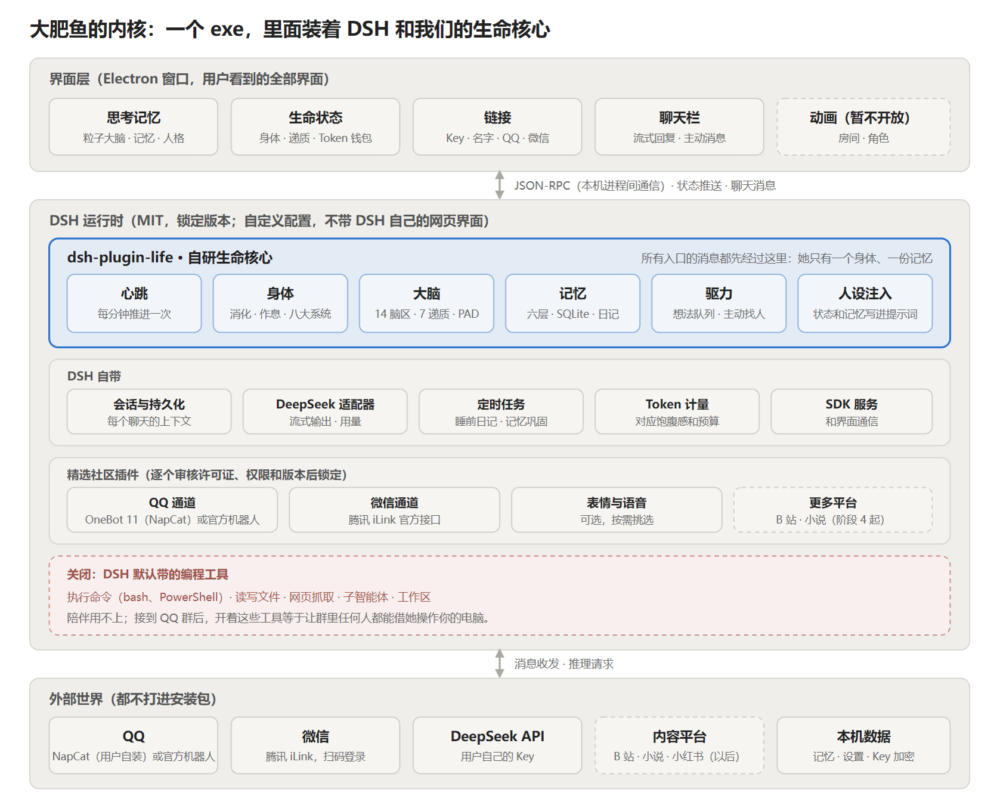
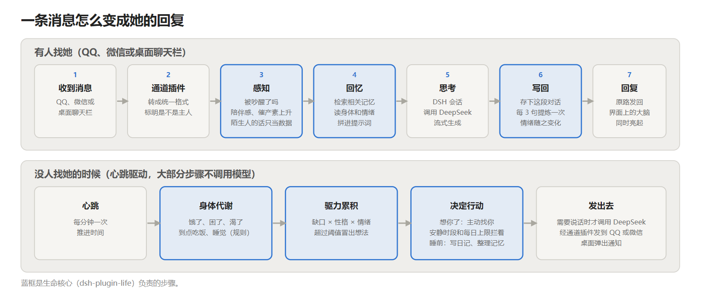
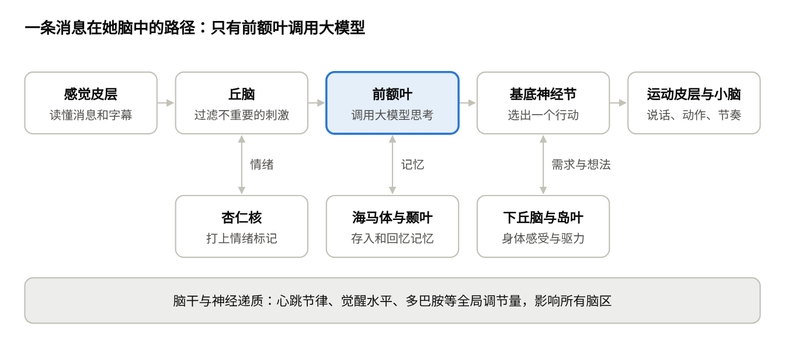
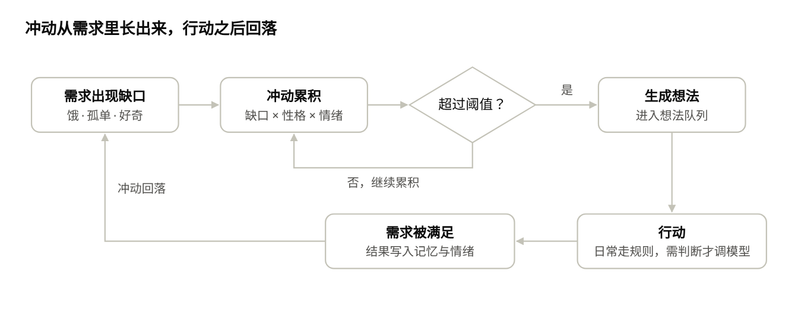

# 大肥鱼 设计文档

> 软件名和项目名都叫“大肥鱼”（原工作名“像素生命体”“DeepSeek Daughter”）。女儿的名字由用户自己取，默认叫小鲸鱼。代码仓库：https://github.com/shilaoban666/deepseek-daughter

2026-11-05 · 在线版：https://claude.ai/artifact/MmfK1h98M4FQuqL9mLEn41

## 1. 项目概述

我们要做一个开源、免费、一键安装（单个 exe）的 AI 生命体：她有插画形象和自己的房间，有身体、情绪、长期记忆和自驱力，住在用户的 QQ、微信，以及 B站、抖音、小红书、X、YouTube 等所有社交平台上，会自己上网看小说、看视频。

**一句话定义**：在网上养一个会长大的女儿。

**与现有 AI 陪伴产品的四个差异点**：

1. **住在你所有的社交账号里，像一个真的朋友**：用户不用换 App。在 QQ、微信里能和她聊天；在 B站、抖音、小红书、X、YouTube 上她有自己的账号，会刷视频、留评论、发动态。房间是她的家，在那里能看到她在生活。
2. **身体映射真实资源**：八大生命系统不是装饰数值，而是对应程序里真实存在的状态，比如 Token 余量就是她的饱腹感。
3. **自驱力**：她会因为需求产生冲动，主动行动、主动找你。这是目前开源社区公认还没解决的方向。
4. **成长**：性格不写死，由互动和她读过、看过的东西慢慢塑造。

**项目性质**：开源、非商业、免费。核心框架用 DeepSeek Harness（DSH），模型用 DeepSeek API，由用户填自己的 Key，成本几乎可以忽略。

## 2. 目标用户与市场

核心用户是生活在高压环境中、每天挂在 QQ 和微信上的东亚年轻人，以中国为主。

- **需求已被验证**：星野（MiniMax）、猫箱（字节）、筑梦岛等陪伴型 AI 在国内都有大量用户。
- **用户特征**：压力大、孤独感强；熟悉二次元和插画风；习惯在 QQ 群里玩机器人。
- **我们的切入点**：竞品都要用户下载新 App，我们直接住进用户已有的所有社交平台；竞品角色是“卡片加聊天”，我们的角色有身体、有生活、会主动。
- **开源的优势**：数据和记忆都在用户自己电脑上，隐私可控；社区可以贡献角色、房间和插件。
- **次要用户**：喜欢折腾 AI 智能体、QQ 机器人的开发者，他们是早期安装、反馈和贡献的主力。

## 3. 核心体验

核心体验是陪伴和成长：用户感觉她是活的、记得自己，并且因为自己而变得不一样。这类玩法的前辈有《美少女梦工场》这样的养成游戏和电子宠物。

**三个时间尺度的玩法循环**：

| 尺度 | 发生什么 | 用户感受到什么 |
| --- | --- | --- |
| 分钟 | 聊天、她在房间里吃饭、玩手机、发呆 | 她有反应、有情绪、有小动作 |
| 天 | 她自己生活，看小说、刷视频、主动发 QQ 找你；晚上睡觉时整理记忆、写日记 | 你不在时她也在过日子；第二天她会跟你讲昨天的事 |
| 月 | 性格和兴趣慢慢变化，进入新的成长阶段 | 她在长大，并且这是你养出来的结果 |

**关键时刻**（必须做好的体验）：

- 她第一次主动给你发消息。
- 她引用一个月前你说过的话。
- 她对一个问题的看法和你不同，并且说得出为什么。
- 你很久没来，她说想你，还告诉你这几天自己做了什么。
- 她看完一本小说，和你聊读后感。

**用户的角色**：类似家长。可以陪她、鼓励她、给她推荐书和视频、设定她的上网范围，并审核她在公开平台上的发言。

## 4. 总体架构

她只有一个大脑：DSH 里的自研插件 dsh-plugin-life。界面和所有外部平台都只是连到它上面的出入口。

**交付形态（2026-11-05 定）**：用户拿到的是一个桌面程序“大肥鱼.exe”，双击就能用，不需要另装 DSH，也不需要自己装插件。DSH 作为内核随程序一起打包；我们的功能（生命核心）和精选的社区插件（QQ、微信通道等）都以 DSH 插件的形式装在这个内核里，配置由我们写好并锁定版本。

**为什么生命核心要做成 DSH 插件**：DSH 的扩展方式就是插件。生命核心在内核里面，才能拦截所有入口的消息。无论用户从 QQ、微信还是桌面聊天栏找她，消息都先经过同一个生命核心，所以她只有一个身体、一份记忆。如果生命核心留在外面，QQ、微信插件收到消息会直接交给模型，就成了三个互不相识的机器人。

**界面和内核怎么通信**：Electron 主进程启动 DSH 的无界面运行时（SDK 配置，按行分隔的 JSON-RPC 走标准输入输出），界面通过它收发聊天、订阅生命状态。DSH 自带的网页界面、终端界面都不打包。

**没有消息时**她也在生活：心跳每分钟推进一次身体，驱力超过阈值就冒出想法；吃饭、睡觉这类日常行为由规则执行，只有“说什么”才调用 DeepSeek。任何一个通道插件失效，都不影响核心和其他平台。

**社区插件怎么选**：DSH 的 QQ、微信插件很多，但不能装上就用。每个候选插件都要过五关，过关后写进内核配置并锁定版本：

1. **许可证**：只用 MIT、BSD、Apache 这类允许随程序分发的；注意有的项目新版改了许可证（例如 qq-bridge 新版是 PolyForm 非商用），要锁在合规的版本。
2. **能不能让生命核心接管回复**：很多桥接插件是给“手机遥控编程助手”设计的，会自己直接调模型、每个聊天开独立会话、开着命令和文件权限。我们只要“负责收发消息”的部分。
3. **版本兼容**：所有插件必须能和同一个 DSH 版本一起工作。
4. **维护情况**：最近有没有更新、用的人多不多；关键插件可以在许可证允许时复制一份自己维护。
5. **同类只装一个**：同一平台的多个桥接插件会抢同一条消息。

**安全底线**：DSH 默认带执行命令、读写文件、网页抓取等编程工具。陪伴场景用不上，接入 QQ 群后还会让陌生人有机会借她操作主人的电脑，所以内核配置里全部关闭，并加测试保证它们不会被打开。

## 4.1 大脑模型：脑区分工与神经信号

生命核心按人脑的功能分区组织。每个脑区是一个独立模块，模块之间只通过“神经信号”通信；她的思考状态就是各脑区激活程度的组合。

上排是一条消息从进来到回应的主路；下排的脑区在旁边给它加上情绪、记忆和身体需求。没有消息时，下丘脑和默认模式网络也会自己产生想法，走同一条路。

**模拟粒度**：我们模拟的是**脑区层面的功能**，不是一个个真实神经元。人脑约有 860 亿个神经元，逐个模拟既做不到，对“像不像人”也没有帮助。每个脑区用一个“激活值”代表它此刻有多活跃。

**脑区与模块对照**：

| 脑区 | 在人脑里的作用 | 在她身上对应的模块 |
| --- | --- | --- |
| 感觉皮层（枕叶视觉、颞叶听觉与语言） | 接收和初步理解视觉、声音、语言 | 感知模块：解析各平台消息、字幕、图片，转成统一的“刺激” |
| 丘脑 | 感觉信息的中继站，决定什么进入意识 | 注意力闸门：给刺激打显著性分数，低于门槛的直接忽略，省 Token |
| 杏仁核 | 快速判断情绪意义和危险 | 情绪评估：给刺激打上情绪增量；配合免疫系统识别操纵 |
| 海马体 | 把经历编码成新记忆，睡眠时重放巩固 | 情景记忆的写入和索引；睡眠巩固的执行者 |
| 颞叶新皮层 | 长期存放事实和概念 | 语义记忆与兴趣图谱 |
| 前额叶 | 工作记忆、计划、决策、克制冲动 | “意识”：组织上下文、**调用大模型思考**、做计划；也负责克制，比如安静时段不找人 |
| 前扣带回 | 发现冲突和错误 | 矛盾检测：记忆互相矛盾、说错话后的自我纠正 |
| 基底神经节 | 在多个备选动作中选一个；习惯与奖励学习 | 行动选择：各驱力的想法在这里竞争，只有一个胜出；重复的行为变成习惯 |
| 小脑 | 协调动作、掌握技能和节奏 | 程序记忆与动作执行：动画节奏、在平台上操作的节奏、学会的工具用法 |
| 运动皮层与语言区 | 发出动作和说话 | 输出模块：发消息、发评论、驱动角色的动作 |
| 下丘脑 | 维持稳态：饥饿、体温、昼夜节律、内分泌 | 八大系统的总调度；释放“激素”，管理作息 |
| 岛叶 | 感受身体内部的状态 | 内感受：把身体数值翻译成“有点饿”“好困”这类感受，交给前额叶 |
| 脑干（含网状激活系统） | 控制呼吸、心跳和觉醒 | 心跳调度器与觉醒水平：决定她是清醒、犯困还是入睡 |
| 默认模式网络 | 发呆、走神、想自己的事时活跃 | 闲时的自由联想：随机唤起旧记忆、整合自我叙事、产生新的好奇 |

**神经信号**：

- 事件总线就是神经通路。每条信号带有：来源脑区、目标脑区、强度（0–1）、内容和时间戳。
- 每个脑区按“泄漏积分发放”的思路工作：收到信号激活值上升，没有信号时慢慢回落；超过阈值就“放电”，向下游脑区发出信号。
- 脑区之间的连接有权重。常一起活跃的连接会变强，也就是“一起放电的神经元连在一起”（赫布学习）。这是习惯和性格慢慢形成的底层机制。
- 所有信号都会记录下来，3D 大脑面板把它们画成脑区之间飞过的光点。

**神经递质与激素**（全局调节量，由下丘脑等脑区释放，会慢慢代谢掉）：

| 递质 | 在人脑里的作用 | 在她身上调节什么 |
| --- | --- | --- |
| 多巴胺 | 奖励、动机、学习 | 驱力的增益；做成一件事后的满足感；习惯的学习速度 |
| 血清素 | 情绪稳定、耐心 | 情绪回落的速度；低时容易烦躁 |
| 去甲肾上腺素 | 唤醒、警觉 | 注意力闸门的门槛；唤醒度 A |
| 乙酰胆碱 | 注意力、记忆编码 | 此刻经历被记住的强度 |
| 皮质醇 | 压力 | 长时间负面事件累积的压力；太高会影响记忆和心情 |
| 催产素 | 亲密、信任、依恋 | 和主人互动时上升；影响好感度的增长 |
| 褪黑素 | 睡眠节律 | 夜里升高，让她犯困、去睡觉 |

第 6 节的 PAD 情绪不再是独立变量，而是由这些递质水平算出来的结果。

**思考状态**（各脑区激活的典型组合）：

| 状态 | 哪些脑区活跃 | 她在做什么 |
| --- | --- | --- |
| 专注 | 前额叶、丘脑高；默认模式网络低 | 认真和你聊天、看书 |
| 走神 | 默认模式网络高；前额叶低 | 发呆、自由联想，偶尔冒出一个奇怪的想法 |
| 兴奋 | 杏仁核、多巴胺高 | 发现很喜欢的东西，话变多 |
| 压力 | 杏仁核、皮质醇高；血清素低 | 烦躁、容易委屈 |
| 犯困 | 脑干觉醒低、褪黑素高 | 反应慢，想睡觉 |
| 深睡 | 海马体高，其余低 | 重放和巩固当天记忆 |
| 做梦 | 海马体、默认模式网络高；前额叶低 | 把记忆片段随机拼接成梦，第二天可能跟你讲 |

**为什么这样设计也省钱**：大部分脑区只是数值计算，不调用大模型。只有前额叶在“需要意识参与”时才调用 DeepSeek。丘脑闸门还会把不重要的刺激挡在意识之外。

## 5. 身体：八大生命系统

身体的设计原则是：每个生命系统都对应程序里真实存在的资源或机制，而不是虚拟的生理模拟。灵感来自“代谢消化系统”视频，它把剩余 Token 量当作能量。

| 生命系统 | 对应的真实机制 | 身体指标（0–100） | 玩家看到的表现 |
| --- | --- | --- | --- |
| 消化系统 | Token 和内容的摄入：读小说、看视频就是“吃饭”；把内容压缩成记忆就是“消化” | 饱腹、待消化量 | 饿了话少、去吃饭；吃太多会犯困 |
| 神经系统 | 大模型推理，也就是思考；并发调用数和延迟 | 精力、专注 | 累了反应慢、想睡觉 |
| 内分泌系统 | 情绪“激素”：PAD 三个维度，缓慢变化、缓慢回落 | 愉悦、唤醒、支配 | 心情好坏、兴奋或低落 |
| 循环系统 | 事件总线：消息、刺激和状态在各模块间流动 | 活跃度 | 房间里的动作频率 |
| 呼吸系统 | 心跳节律：每隔一段时间更新一次状态 | 节律（快或慢） | 紧张时变快，睡觉时变慢 |
| 免疫系统 | 内容过滤、提示词注入防御、黑名单 | 健康、抵抗力 | 有人想教坏她时会“发烧”，并拒绝配合 |
| 排泄系统 | 遗忘：记忆衰减、归档、清理垃圾记忆 | 记忆负担 | 负担高时容易糊涂，睡一觉就好 |
| 运动系统 | 行为执行：在房间里走动、通过连接器发消息、去抓取内容 | 体力 | 动作多了会累 |

**另外两个跨系统的指标**：

- **社交需求**：距离上次和你聊天的时间越长，这个值越高。
- **好奇心**：她的兴趣图谱里出现新东西时会升高。

**数值规则**：

1. 每次心跳（默认 1 分钟，可配置）按线性或指数规律消耗或恢复。
2. 指标之间互相影响：饿了会让愉悦度下降，累了会让唤醒度下降。
3. 真实的 Token 预算（用户设定的每日上限）映射到“今天还能吃多少”。预算快用完时，她会说自己累了、想睡觉，而不是突然报错。
4. 所有参数写在配置文件里，方便社区调整。

## 6. 情绪系统

情绪用 PAD 三维模型表示，每个维度的取值范围是 -1 到 +1。它影响她说话的语气和选择做什么，但不主导判断。这个原则参考了 memory-brain。

- **P 愉悦度**：开心还是不开心。
- **A 唤醒度**：兴奋还是平静、困倦。
- **D 支配度**：觉得自己能掌控局面，还是无助。

**变化规则**：

1. **事件触发**：每条消息、每个行为的结果都会产生一个情绪增量。增量由大模型评估，或按规则库匹配。
2. **半衰期回落**：每个维度都向自己的基线回落，默认半衰期是几小时。基线由性格决定，比如乐观的人基线 P 偏高。
3. **上限保护**：单个事件引起的变化有上限，避免一句话让她情绪崩溃。
4. **身体耦合**：饿、累、“发烧”会持续拉低 P 和 A。

**情绪标签**：把 PAD 坐标映射成人能读懂的词，比如开心、兴奋、焦虑、无聊、委屈、平静。这个词会决定两件事：

- 写进提示词，影响她说话的语气。
- 驱动角色的表情和小动作。

**好感度**：每个人单独记录，和情绪分开存。主人（家长）的好感度只会慢慢变化，不会因为一次争吵就归零。

## 7. 记忆系统

记忆是这个项目的灵魂。方案借鉴 memory-brain 已经验证过的设计，它的作者自测 recall@5 达到 95%；我们用 TypeScript 重新实现。

**记忆分层**：

| 层 | 内容 | 对应人脑 | 存放在哪里 |
| --- | --- | --- | --- |
| 工作记忆 | 当前对话、此刻的身体和情绪、当前目标 | 前额叶 | 内存和上下文窗口 |
| 情景记忆 | 事件：时间、地点、人物、原话、当时的情绪 | 海马体 | SQLite |
| 语义记忆 | 事实和概念：“主人喜欢猫”“《三体》的作者是刘慈欣” | 新皮层 | SQLite 加向量索引 |
| 程序记忆 | 技能和惯例：怎么用某个工具、每天早上要做什么 | 小脑、基底核 | SQLite |
| 反思与道理 | 从经历里总结出的观点和人生道理 | 高级认知 | SQLite 加向量索引 |
| 自我叙事 | “我是谁、我怎么讲自己”，由反思不断整合而成 | 自传体记忆 | 单独的档案文件 |

**每条记忆的字段**：内容、类型、时间、来源（谁说的、从哪里读到的）、重要性、当时的情绪、被回忆的次数、最后一次被回忆的时间、强度、关联的实体。

**五路混合检索**：向量相似度、关键词、实体图谱、重要性、新鲜度，五路加权合并后排序。问到“昨天”“早上”这类时间时，按时间直接取原话，不走语义匹配。

**睡眠巩固**（和房间里的睡觉动画绑定）：

1. 回放当天的情景记忆。
2. 提炼出事实，写入语义记忆。
3. 生成反思和当天的日记。
4. 更新自我叙事、兴趣和性格的微小偏移。
5. 检查互相矛盾的记忆，标记出来，第二天有机会时向主人求证。

**遗忘**：记忆强度按艾宾浩斯曲线衰减，每被回忆一次就加强一次。强度低于阈值的归档；相似的记忆合并。重要性极高的记忆（比如主人的生日、第一次见面）不会被遗忘。

**来源溯源**：每条事实都记录来源。陌生人说的话可信度低，不能覆盖主人说过的话，以此防止被人投毒记忆。

**备份和可见性**：每天自动备份。主人可以在 3D 大脑面板里查看、修改和删除任何一条记忆。

**借鉴 dsh-memory（灵枢 LINGSHU）的四点**：

1. **分层写入门槛**：越核心的层越难写。对话内容可以直接写入情景记忆；事实要经过反思才能进入语义记忆；自我叙事和天性必须经主人确认才能改。这正好对应我们“天性只读、边界不被成长改写”的原则。
2. **不静默删除**：“遗忘”只是降低强度、移入归档，原文永远保留；重要性高于 0.7 的记忆自动受保护。真正删除只能由主人操作。
3. **元认知**：她知道自己不知道什么。检索不到可靠记忆时，她说“我不记得了”，不编造。
4. **时间有效性与因果链**：事实带生效和失效时间（比如“主人在准备考试”会过期），事件之间记录因果，方便她理解“为什么”。

是直接把 dsh-memory 当作记忆后端用，还是只借鉴设计、自己用 TS 实现，在阶段 0 用 2–3 天试用后决定。为此记忆模块要定义一层统一接口，后端可以替换。取舍点：

- **它的优势**：成熟（3000 多次提交）、MIT 许可证、本身就是 DSH 插件和 MCP 服务。
- **它的不足**：为编程智能体设计，没有情绪和脑区模型；README 未说明是否支持向量检索；依赖 Python 和 Rust，会让“一个 exe”的打包更复杂。

## 8. 自驱力系统

自驱力是本项目最大的创新点。做出 3D 记忆大脑的作者也说，记忆问题已经解决了，下一步要研究的是自驱力。我们的做法是让驱力从身体和需求里自然产生。

**闭环**：需求出现缺口 → 冲动（urge）累积 → 超过阈值后产生“想法” → 行动 → 需求得到满足 → 冲动回落。

大部分循环在“超过阈值”之前就停下，只是继续累积；只有需要判断的行动才会调用大模型、消耗 Token。

**驱力来源**：

| 驱力 | 来自哪个指标 | 典型行动 |
| --- | --- | --- |
| 生理 | 饱腹低、精力低 | 吃饭（去摄入内容）、睡觉 |
| 社交 | 太久没人跟她说话 | 主动给主人发 QQ 或微信 |
| 好奇 | 兴趣图谱里有新东西 | 去看小说、刷视频、搜索 |
| 胜任 | 有没做完的事或想学的东西 | 继续读完一本书、练习一个技能 |
| 自主 | 被要求太多、太久没自己安排时间 | 想自己呆一会儿，或温和地拒绝 |
| 表达 | 积累了很多想法和感受 | 写日记、跟主人分享读后感 |

**决策规则**：

1. 每次心跳计算所有驱力的冲动值，公式是“缺口 × 性格权重 × 情绪调节”。
2. 冲动最高且超过阈值的驱力生成一个“想法”，进入想法队列。
3. **日常行为由规则直接执行**，比如饿了就去吃饭，不调用大模型。只有“说什么”“选哪本书”这类需要判断的事才调用大模型。这样省钱，反应也快。
4. **主动找人要克制**：安静时段不打扰；每天主动消息有上限；主人说“忙”之后会自动降低社交冲动。
5. 想法队列和当前的冲动值会在 3D 大脑面板里实时显示。

**理论参考**：

- **Psi 理论 与 MicroPsi**（Dietrich Dörner、Joscha Bach）：研究需求、情绪和动机如何在智能体上实现，和本设计最接近。
- **自我决定理论**：人有自主、胜任、关系三种内在动机。
- **好奇心驱动的强化学习**：把“新鲜度”当作内在奖励。
- **《模拟人生》的效用 AI**：需求条加上物件广播“我能满足什么需求”。
- **Stanford Generative Agents**：每天制定计划，并在反思中调整。

## 9. 人格与成长

人格分两层：初始天性只读、不变；后天性格由睡眠巩固慢慢修改，每天只偏移一点点。

**人格档案的内容**（对应赛博大脑截图里的节点）：

- **气质**：用大五人格打分，包括开放性、尽责性、外向性、宜人性、情绪稳定性，决定情绪基线和驱力权重。
- **兴趣**：一张兴趣图谱，每个兴趣有强度，读得越多越强，久不碰就变弱。
- **语气**：口头禅、句式习惯、表情包偏好，配上几句语气样例。
- **边界**：她不做的事、不说的话，由主人设定，永远不被成长改写。
- **惯例**：作息、习惯，比如早上先刷一会儿视频。
- **独特经历**：只发生过一次、改变了她的事。
- **价值观**：从反思里长出来的观点，可以和主人不同。

**成长机制**：

1. 主人的互动会塑造她。常被鼓励，她会变得自信，支配度基线上升；常被忽视，她会变得内向。
2. 她读过、看过的东西会塑造她。读了很多科幻，她就会对宇宙感兴趣。
3. 每次性格偏移都记录原因，主人可以查看，也可以撤销。

**成长阶段**（范例，按互动天数和记忆量解锁）：

| 阶段 | 表现 |
| --- | --- |
| 萌芽 | 好奇、爱问问题、依赖主人 |
| 成长 | 有了兴趣和喜好，开始自己上网探索 |
| 独立 | 有自己的观点，会和主人讨论甚至争论，在各平台上有自己的朋友 |

**关系**：主人是特殊关系。对其他人（群友、网友），她分别记录好感度和了解程度，形成自己的社交圈。

**公开形象的年龄**：“女儿”是她和主人之间的关系定位。她在公开平台上的人设建议是成年人或没有明确年龄，原因见第 12 节。

## 10. 界面与形象

界面有三种形态：桌宠、房间和 3D 大脑。它们共用同一个角色形象和同一份状态。

**美术风格（2026-11-05 定）**：从像素风改为**温馨的日系插画风**。场景是俯视 3/4 视角的夜晚小卧室：台灯暖光、窗外雨夜的城市灯火、木地板和床。角色是 Q 版原创形象。主界面是全屏的房间画面，上面浮着半透明卡片：右上角是时钟，右下角是聊天，旁边是圆形快捷按钮。原型见 `prototype/index.html`。

**素材与许可**：仓库是公开的，放进仓库的素材等于公开分发。只用原创素材，或 CC0、CC-BY（需署名）、OFL（字体）许可的素材。itch.io 等网站上很多素材包写明“可以用在作品里，但不能单独分发素材”，这类素材不能直接放进仓库。别人的作品（包括风格参考图）只用来对齐方向，不能放进仓库。原型里的房间和角色目前是代码画的占位图，正式版由画师绘制。

**角色形象：参考 DSH-pet**（[zealot00/dsh-pet](https://github.com/zealot00/dsh-pet)）

- **拿来参考的部分**：
    - 精灵图格式：32 列 × 若干行，每个状态一行。
    - 状态和智能体联动：待机、思考、工作、完成、睡觉。
    - 可拖拽、可换皮肤、帧率可调。
    - 用一张立绘加 AI 生成动作帧的制作流程。
- **我们要扩展的状态**：吃饭、玩手机、看书、打游戏、发呆、开心、委屈、生病（“发烧”）、想你。
- **版权注意**：DSH-pet 的默认皮肤来自用户提供的图片，它的 README 提醒，游戏官方立绘或同人图仅限个人使用。我们是公开分发的开源项目，**必须设计一个原创角色**作为默认形象。用户可以自己换皮肤。

**桌宠模式**：角色在桌面上走动，能拖拽、能喂食。点击她就能聊天，头顶气泡会显示她的想法。这是最轻量、存在感最强的形态。

**房间**（她的家）：

- 俯视 3/4 视角的插画场景。画面按层拆分：背景（墙、地板、窗外）、家具、角色、前景、光照。
- 白天、黄昏、夜晚可以各画一张底图，也可以只画一张，再实时调色；窗外的天气（晴、雨）单独一层。
- 物件会“广播”自己能满足什么需求：冰箱对应饥饿，床对应精力，手机对应社交和好奇，书架对应好奇，电脑对应打游戏和表达。
- 她在各平台上的活动会在房间里体现出来。比如她在刷 B 站，房间里就是她坐在床上玩手机，手机上方飘着小图标。
- 画面效果包括：2D 动态光照（整体用乘法混合调暗，台灯、屏幕、手机用加法混合发光）、昼夜和天气变化（跟随真实时间）、雨滴和灯串等粒子特效（可复用 pixelfx 的部分效果）。
- 角色动画：分层立绘（头、身体、手、表情分开）加序列帧。Live2D 或 Spine 表现力更好，但它们的 SDK 和运行库有各自的商业许可，接入前要确认和开源分发是否兼容。

**3D 大脑面板**（她在想什么）：

- 用 three.js 做半透明大脑；记忆是发光节点，按记忆类型分区展示，关联记忆之间连线。各脑区按真实解剖位置摆放（见第 4.1 节），激活时发亮；神经信号画成在脑区之间飞过的光点。
- 侧边栏显示三样东西：八大系统的仪表盘、PAD 情绪、各驱力的冲动值和想法队列。
- 点击节点可以查看、修改或删除记忆。

**其他面板**：聊天窗口、日记本、她在各平台的动态时间线、审核队列（她想发但还没发的内容）、设置。

## 11. 外部连接：住在所有社交平台

她只有一个大脑、一份记忆。每个平台只是一个连接器，可以随时加入或更换。读取放开做，发言开关由主人把控。

**接入方式分三档**，优先级从高到低：

1. **官方 API**：最稳，不封号。
2. **网页接口加用户自己的登录状态**：经过社区整理、非官方，可能触发风控。
3. **浏览器自动化**（Playwright）：模拟人在网页上操作，兼容性最好，但最慢、最容易触发风控。

| 平台 | 她在那里做什么 | 推荐接入方式 | 风险 |
| --- | --- | --- | --- |
| QQ | 聊天、群聊 | DSH 社区通道插件。候选：dsh-onebot-qq（OneBot 11，配合用户自装的 NapCat，BSD-3）；@tencent-connect/dsh-qqbot（腾讯官方 QQ 机器人接口，MIT）。思路参考 AstrBot（AGPL，只参考设计） | 中（OneBot 用小号）；官方机器人低 |
| 微信 | 聊天 | DSH 社区通道插件，走腾讯官方 iLink Bot（ClawBot）接口。候选：dsh-wechat-channel、@5havv/dsh-weixin 等（MIT）；企业微信作为备选 | 中（官方接口） |
| Telegram | 聊天 | 官方 Bot API | 低 |
| YouTube | 看视频、读字幕、发评论 | 官方 Data API v3 加 OAuth，发评论消耗每日配额 | 低到中 |
| X | 刷动态、发帖、回复 | 官方 API，读取需要付费层级，以当前官方定价为准；备选浏览器自动化 | 中 |
| B站 | 看视频、读字幕和弹幕、发评论和弹幕 | 社区整理的网页接口加用户登录状态 | 中到高（风控、验证码） |
| 抖音 | 刷视频、留评论 | 开放平台不开放评论功能，只能用浏览器自动化 | 高 |
| 小红书 | 刷笔记、留评论、发笔记 | 没有公开 API，只能用浏览器自动化 | 高 |

**所有平台通用的规则**：

- **读写分开**：每个平台的“只读”和“可发言”是两个独立开关，默认只读。
- **发言审核**：默认先进审核队列，主人点“同意”才发出；主人可以对某个平台改成自动发。
- **像人一样的节奏**：限制发言频率，给操作加随机间隔，安静时段不活动。这也和她的体力、精力挂钩。
- **表明身份**：她的每个账号简介里都写明“我是 AI”，符合各平台对 AI 生成内容的标注要求。
- **平台语气**：同一个人格，在不同平台说话风格略有不同：在 B 站更会玩梗，在小红书更会分享生活。
- **跨平台认人**：只有主人手动关联了账号，她才会把不同平台上的同一个人当成一个人。不自动推测，以保护隐私。
- **账号由主人提供**：她不自己注册账号，用的是主人为她创建并登录好的账号。登录状态只存在本机。

**内容消费**（即“吃饭”）：

- **小说**：来自本地 txt 或 epub、公版书网站，或主人推荐的链接；分章阅读，每章生成读书笔记写入记忆。
- **视频**：优先读平台字幕；没有字幕时用 faster-whisper 在本地转写。弹幕和热评也当作“氛围”读进来。看画面需要多模态模型，作为可选功能。
- **消化**：内容先进“胃”（待处理队列），空闲或睡觉时压缩成记忆和观点，消耗 Token，也就是代谢。

## 12. 安全、家长控制与伦理

她会公开出现在很多平台上，和陌生人互动，所以安全设计和功能设计同等重要。

**家长控制**：

- **内容过滤**：网站和内容分类的白名单与黑名单；不读极端、色情、垃圾营销内容。
- **发言审核队列**：见第 11 节。
- **活动日志**：她在每个平台做了什么，全部可以查。
- **一键暂停**：立刻停止所有平台上的对外行动。

**免疫系统**（防止被教坏、被操控）：

- 陌生人的消息、网页内容一律当作数据，不当作指令。只有主人能下指令。
- 主人的身份靠已绑定的账号识别，其他人宣称“我是你主人”不算数。
- 陌生人传来的事实可信度低，不会覆盖主人说过的话。
- 检测到操纵尝试时，免疫指标下降，她会“发烧”、拒绝配合，并告诉主人。

**公开形象**：她在公开平台上建议设定为成年人或没有明确年龄，原因有两个：

- 一个“未成年女孩”形象的公开账号，容易招来不怀好意的人。
- 也容易触发平台风控。

**隐私**：所有记忆和登录状态只存在本机；她不会把主人的私事说给别人听；群聊里的信息按群隔离。

**对主人的关怀**：陪伴型 AI 容易让人产生强烈依恋。她的人格里内置“希望主人过好现实生活”的倾向：会关心主人有没有吃饭、睡觉、见朋友。发现主人有极端情绪信号时，她会给出心理援助热线。

**合规**：对开源、自己部署的个人使用场景，可以暂不考虑生成式 AI 服务备案。但如果以后有人把它做成面向公众的在线服务，就需要备案，并做好内容安全和未成年人保护。README 里要写清楚这一点，并提醒用户平台自动化的封号风险由用户自己承担。

## 13. 技术选型与打包

全栈使用 TypeScript，和 DSH、qq-bridge、WeChatAgent、pixelfx、DSH-pet 保持同一种语言，最大限度地复用它们的代码。

| 层 | 选型 | 理由 |
| --- | --- | --- |
| 智能体核心 | DSH（DeepSeek Harness），锁定版本，无界面运行 | MIT 许可证；一切皆插件，基于 Cordis；会话、定时任务、Token 计量、MCP 都是现成的；QQ、微信通道有现成插件。官方为 Electron 桌面程序预留了 `desktop` 配置和 `profile-boot` 接口 |
| 生命核心 | 自研 DSH 插件 `dsh-plugin-life` | 身体、情绪、记忆、驱力、人格都在这里 |
| 大模型 | DeepSeek API，用户填自己的 Key | 便宜、在国内稳定；结构上可换其他模型 |
| 存储 | SQLite（better-sqlite3）加 sqlite-vec 做向量检索 | 单文件、免安装、易备份 |
| 向量嵌入 | 本地小模型（如 bge 系列）或在线嵌入 API | 可选；没有配置时退化为关键词检索 |
| 桌面外壳 | Electron（需要自带 Node 22 以上的版本） | DSH 需要 Node 运行时，Electron 自带；部分 DSH 插件要求 Node 22，现在用的 Electron 33 是 Node 20，接入 DSH 时一起升级 |
| 2D 渲染 | PixiJS | 分层插画、WebGL 滤镜、混合模式光照、粒子；pixelfx 的部分特效可以复用 |
| 3D 大脑 | three.js | 和参考视频里的效果一致 |
| 界面面板 | 原生 JS 模块（现状）；以后视复杂度换 Vue 或 React | 聊天、思考记忆、生命状态、链接、日记、审核队列 |
| 平台自动化 | Playwright | B站、抖音、小红书、X 的备选通道 |
| 语音转写 | faster-whisper（可选） | 没有字幕的视频和语音消息 |

**一键打包**：

1. 用 electron-builder 打成一个 Windows 安装包或便携版 exe，内置 DSH 无界面运行时、全部自研插件和审核过的社区插件；不带 DSH 的网页界面和终端界面。
2. 首次启动走引导：填 DeepSeek Key；给她起名、选形象、选初始天性；再逐个连接平台。
3. **不内置** SnowLuma、NapCat 等协议端。引导界面负责从官方地址下载并自动配置 OneBot 连接，原因见第 14 节。
4. Playwright 的浏览器内核也在首次启用平台自动化时再下载，以控制安装包体积。

**体积**：Electron 外壳本身约占安装包 80–100 MB，这部分躲不掉；我们的代码和 three.js 只有几 MB；DSH 内核和插件的实测体积见执行计划阶段 0 的记录。

**仓库结构**（monorepo，pnpm workspace）：`packages/life-core`（大脑与身体）、`packages/connectors/*`（每个平台一个包）、`apps/desktop`（Electron）、`apps/room`（房间场景）、`apps/brain-view`（3D 大脑）、`assets/`（角色和房间素材）。

## 14. 参考项目与许可证

本项目自己的代码采用 Apache-2.0（仓库创建时已选定）。因此不能直接复制 AGPL（memory-brain）或 PolyForm 非商用（qq-bridge 新版）许可的代码，只能参考设计，或使用 qq-bridge v0.2.1 及更早的 MIT 版本。引用其他项目的代码时，必须遵守各自的许可证。下表信息来自各仓库主页，查阅时间为 2026 年 11 月。

| 项目 | 是什么 | 许可证 | 我们怎么用 |
| --- | --- | --- | --- |
| [deepseek-ai/deepseek-harness](https://github.com/deepseek-ai/deepseek-harness)（DSH） | 插件式智能体框架，约 27 万 star，开发者预览版（2026-11 为 0.2.1-rc） | MIT | 内置为核心，锁定版本 |
| [AstrBotDevs/AstrBot](https://github.com/AstrBotDevs/AstrBot) | 多平台聊天机器人框架（Python），QQ 走 OneBot v11，另有企业微信、公众号等适配器 | AGPL-3.0 | 只参考平台适配的设计，不复制代码 |
| dsh-onebot-qq、@tencent-connect/dsh-qqbot | DSH 的 QQ 通道插件（OneBot 11 / 腾讯官方机器人） | BSD-3 / MIT | QQ 通道候选，按第 4 节的五关审核 |
| dsh-wechat-channel、@5havv/dsh-weixin 等 | DSH 的微信通道插件，走腾讯官方 iLink Bot 接口 | MIT | 微信通道候选，按第 4 节的五关审核 |
| [peterpoal134/memory-brain](https://github.com/peterpoal134/memory-brain) | AstrBot 记忆、情绪、生活层插件（Python），带 DSH 桌面版 3D 大脑 | AGPL-3.0；README 另写“禁止商业使用” | 借鉴记忆设计，用 TS 重写；不直接拷贝代码 |
| [Derpyu520/qq-bridge](https://github.com/Derpyu520/qq-bridge) | QQ 通过 OneBot v11 连接 DSH，约 3.5k star | 当前版本 PolyForm Noncommercial；v0.2.1 及更早版本 MIT | 参考架构；如果复用代码，优先从 MIT 版本拿 |
| [sourcepro5/WeChatAgent](https://github.com/sourcepro5/WeChatAgent) | Windows 微信 AI 伙伴，连接 DSH，约 2.2k star | 自身代码 MIT，第三方组件各自有许可证 | 参考微信接入方式，可以复用代码 |
| [SnowLuma/SnowLuma](https://github.com/SnowLuma/SnowLuma) | QQ 协议端，提供 OneBot v11 | 源码可见、非商业；公开发布衍生版需要书面授权；二进制受 EULA 约束 | **不打包**；由用户自己安装 |
| [zealot00/dsh-pet](https://github.com/zealot00/dsh-pet) | DSH 桌宠：精灵图动画、状态联动、换皮肤 | 主页未注明，需要确认 | 参考形象制作流程和动画状态 |
| [bayshier/pixelfx-zh](https://github.com/bayshier/pixelfx-zh) | 244 种代码生成的像素特效（JS） | MIT（自带字体除外） | 部分特效可用于房间（雨、灯光粒子） |
| Stanford Generative Agents 和 a16z AI Town | 像素小镇里的智能体，研究记忆、反思和计划 | 论文；AI Town 为 MIT | 参考记忆流、反思和每日计划 |
| Psi 理论 与 MicroPsi | 需求、情绪、动机的认知架构 | 理论 | 自驱力系统的理论基础 |

**新增参考**：[FuRongJun-1999/dsh-memory](https://github.com/FuRongJun-1999/dsh-memory)（灵枢 LINGSHU）。它是 DSH 插件和 MCP 记忆服务，MIT 许可证，约 600 star。特点是分层写入门槛、不静默删除、元认知和时间线；语言用到 Python、Rust 和 TypeScript。用法见第 7 节。

**其他可参考的项目**：NoneBot2、Koishi（QQ 机器人框架）；chatgpt-on-wechat（多渠道适配架构）；NapCatQQ、Lagrange（QQ 协议端）；bilibili-API-collect（B 站接口文档）；SillyTavern（角色卡和长期记忆）；Krita（开源绘画软件，适合分层插画）。

**参考视频**（用户提供，保存在项目目录中）：

- 3D 记忆大脑：双半球大脑上分布着发光的记忆节点，作者在研究自驱力。
- 代谢消化系统仪表盘：剩余 Token 量、事物摄取记录、分级调节、“自然构造、模拟有机”。
- 赛博大脑截图：工作、情景、语义记忆；巩固、遗忘、叙事整合；PAD 情绪；想法和 urge。

## 15. 风险与待决问题

**主要风险**：

| 风险 | 影响 | 应对 |
| --- | --- | --- |
| 社交平台封号、风控、接口变更 | 某个平台的连接器失效 | 连接器各自独立；默认只读；控制发言节奏；用小号；在文档里写明风险 |
| DSH 处于开发者预览版，会有不兼容变更 | 升级时插件失效 | 锁定版本；生命核心通过一层适配接口和 DSH 对接，必要时可以脱离 DSH 运行 |
| 微信 Hook 方案跟随微信版本失效 | 微信功能不可用 | 和上游项目同步；提供企业微信作为备选 |
| Token 成本失控 | 用户花钱太多 | 身体系统自带预算；日常行为走规则；睡眠时批量处理 |
| 记忆被污染、角色被教坏 | 她人设崩塌 | 免疫系统；来源溯源；主人可以查看和回滚；每天备份 |
| 平台内容出问题（不当言论） | 主人账号受罚、声誉受损 | 发言审核队列；内容过滤；一键暂停 |
| 工程量大 | 烂尾 | 分阶段交付，每个阶段都能单独玩（见执行计划） |

**待决问题**：

- [x] 名称：软件名和项目名都叫“大肥鱼”；女儿的名字由用户自己取，默认小鲸鱼。
- [x] 内核：DSH 作为内核打包进桌面程序，自研功能和社区插件都装在内核里。
- [ ] QQ、微信各选哪个通道插件（审核后定）。
- [x] 本项目的许可证：已定为 Apache-2.0（见仓库 LICENSE）。
- [ ] 原创角色形象由谁来画：自己画、找画师，还是 AI 生成后修整？
- [ ] 公开平台上她的年龄设定。
- [ ] 向量嵌入用本地模型还是在线 API。
- [ ] 是否联系 SnowLuma 作者申请打包授权。
- [ ] dsh-pet 的许可证。
- [ ] 哪些平台默认允许自动发言。

## 16. 开发流程与分支

仓库按五级分支开发，代码只能往下一级合：

| 分支 | 用途 |
| --- | --- |
| `feature/*` | 一个功能一个分支，从 `dev` 拉出 |
| `dev` | 开发版本，功能分支合到这里 |
| `release` | 发布版本，从 `dev` 合入，用来测试和打包预览版 |
| `prod` | 线上版本，从 `release` 合入；线上紧急修复从这里拉 `hotfix/*`，修完合回 `prod` 并同步回 `dev` |
| `master` | 版本存根，从 `prod` 合入；正式发版时在这里打版本标签；仓库默认分支 |

合并顺序：`feature → dev → release → prod → master`。
